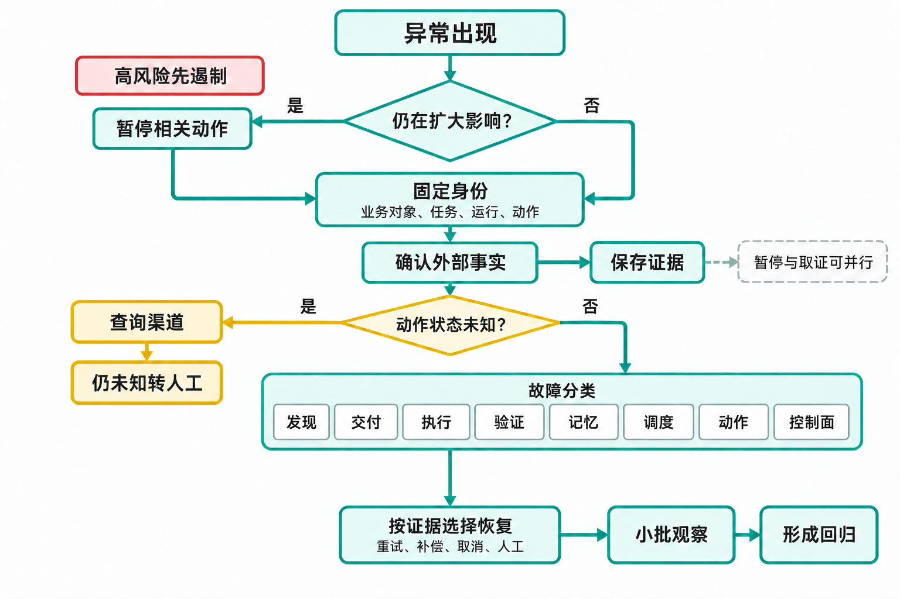

# 附录 C 故障排查手册

> 原附录 C 全文外移至配套资料（2026-11）；文中章号已按新版调整。

循环故障常以"结果不对""今天没跑""费用突然上涨"出现。先保护业务，再沿任务证据定位。不要在不知道根因时反复运行、扩大权限或修改多个配置。

## C.1 排障的固定顺序

遇到异常时，按以下顺序处理：

1. **限制影响**：暂停相关任务或动作，记录暂停范围，并撤销尚未执行且不再适用的批准；
2. **固定身份**：记录业务对象、`task_id`、`run_id`、动作 ID（`operation_id`）和查询时间窗口，确保后续证据能对上同一意图；
3. **确认外部事实**：向目标系统核对消息、付款、发布、订单或部署是否实际发生，不把 Agent 的对话当成事实；
4. **保存证据**：保存任务包、输入与版本、权限决定、原始返回、退出码和产物位置，避免修复时覆盖现场；
5. **分类故障**：把现象归入发现、交付、执行、验证、记忆、调度、动作或控制面，并写下分类依据；
6. **选择恢复**：根据外部状态和风险选择继续、重试、重建运行、转人工、补偿或取消，并记录决定人；
7. **限制恢复**：先处理小批、最新任务或测试对象，设置观察窗口和再次暂停条件，再逐步扩大范围；
8. **形成回归**：把事故转成去标识样本、规则、权限或运行手册修改，并指定验证结果的保存位置。

暂停和取证可以并行。对于数据越界、资金、删除和大范围外发，不要为了先找完根因而继续让动作发生。

接口超时后，现场最先看到的是"没有收到成功响应"，但这还不足以决定是否重试。若消息已经发出，重新运行会扩大影响；若请求确实未执行，后续才有条件评估恢复。图 1 把这项判断放在故障分类之前，同时保留高风险先遏制的入口，避免调查者一边找原因，一边让同类动作继续发生。



*图 1 一页排障入口*

图中"固定身份"让查询对象保持一致：业务对象说明影响了谁，任务与运行说明哪次尝试出了问题，动作标识则把查询连到已发出的请求。缺少这些关联，就可能把另一条消息或另一次运行的结果误当成本次成功。暂停与取证可以并行；即使"仍在扩大影响"的判断为"否"，也仍要沿这些身份确认外部事实，不能直接跳到恢复。

黄色查询分支需要按查明的事实收尾：确认已执行，就保存回执并核对完成条件；确认未执行，才评估授权、有效期和重试条件；仍然未知，则保留记录并转人工。图没有展开三种结果的全部处置，具体见 C.5。"已查询"本身不构成可重试的依据，人工接手也不能把未知当作未执行。

只有查清相关状态与恢复依据，才进入底部的小批观察。选择重试、补偿、取消或人工处理，取决于已发生的业务影响，不能只看工具错误码；恢复后仍需保留再次暂停条件。下一节的通用排障记录用于保存这些判断及未决事项，后面的症状清单再帮助调查者定位具体控制缺口。

## C.2 通用排障记录

这份记录从报告现场开始填写，不必等根因确定。先用任务、运行和动作身份限定调查对象，把已查询到的外部事实与初步分类分开；尚未确认的项明确写"待确认"，并连接到下一检查、负责人和截止时间。"已暂停什么"记录当前保护措施，"恢复前必须满足"记录解除措施所需证据，两者都清楚后才能安排有限恢复。

```text
报告时间 / 报告人：
现象：
业务影响与可能最大范围：
任务、运行、业务对象和动作 ID（`operation_id`）：
当前仍在发生吗：
已暂停或限制什么：
外部真实状态：
使用的输入、模型、工具、规则、权限和版本：
最近变化：
初步分类：
下一检查及负责人：
升级对象与截止时间：
证据位置 / 保留期限：
当前状态（调查 / 暂停 / 恢复中 / 已关闭）：
恢复前必须满足：
```

"AI 出错"不是故障分类。"客户 A 的批准草稿 v4 在订单版本变化后仍被发送"可以检查。

## C.3 今天没有生成结果

**先查**

1. 今天是否有符合条件的原始信号；
2. 发现任务是否运行，使用哪个时区和业务日历；
3. 信号是否被去重、合并、过滤或标为过期；
4. 是否创建 `task_id`，任务当前在哪个状态；
5. 队列、预算、依赖和人工门禁是否阻塞；
6. 执行是否完成但交付位置错误；
7. 结果是否被验证退回或因范围外停止。

**常见根因**

- 调度器按 UTC 运行，团队按本地日期查找；
- 输入源字段改名，发现规则返回空集合；
- 去重键过宽，把不同业务对象合并；
- 全局预算或人工队列触发背压（Backpressure，即暂缓上游产生以免队列继续增长）；
- 任务完成，但写入旧草稿目录或错误账号；
- 验证失败被界面隐藏成"无结果"。

**不要做**

不要连续点击运行。先确认有没有已有任务和外部产物。不要把过滤规则全部关闭；这会把积压信号一次展开。

排查第 5 章的定时摘要时，先确认查询的是原来的任务或触发绑定，再核对日程、状态与运行记录。有运行记录而没有合格草稿，应继续查输入、执行和输出位置；没有运行记录，则先查触发与设备条件。两类问题不能都通过再创建一个定时任务解决。

**恢复证据**

从一条确定应处理的信号创建任务，能沿状态到达正确草稿位置；旧信号按业务时效明确重放、合并或丢弃。

## C.4 同一任务跑了两次

**先查**

- 两次记录的 `task_id` 是否相同；
- 触发来自重发事件、轮询重叠还是人工点击；
- 租约（Lease，即限定一段时间的处理权）、唯一约束或条件写入是否生效；
- 第一次运行是否超时但仍继续；
- 两次运行是否都产生外部副作用；
- 幂等键（用于关联同一业务意图的重复请求）由谁生成，字段是否包含不稳定时间戳。

**根因区别**

**重复运行、无重复动作**说明任务层有浪费；外部未出现重复动作，门禁是否起效仍要按动作账本核对。修发现去重与租约。

**重复动作、同一业务意图**说明业务幂等或状态确认失败，立即限制同类动作并调查外部影响。

**两个任务其实是不同意图**说明 `task_id` 过宽，例如同一邮件会话中的两个请求被合并。修任务身份，不能只删除第二项记录。

**不要做**

不要通过隐藏重复记录解决。不要把所有事件内容哈希当业务身份；正文小改可能改变哈希，同一付款意图仍会重复。

## C.5 接口超时，不知道动作是否成功

**立即状态**

任务进入"动作状态未知"。停止普通重试，保留请求 ID、动作 ID（`operation_id`）、业务幂等键、目标、金额或内容哈希。

**查询顺序**

1. 用外部请求或动作 ID 查询是否已有结果，并保存返回状态；
2. 用业务幂等键查询同一业务意图的其他请求，核对是否已有外部对象；
3. 在目标对象的时间窗口和版本中核对，排除读到缓存或其他版本的结果；
4. 仍无法确认时，将证据包转给负责该动作的业务责任人，继续核对并决定是否需要遏制业务影响；人工接手也不能把未知状态当成未执行而重新提交。

外部系统明确没有执行，且请求仍在有效期与预算内，才允许新尝试。查询到已执行时，记录原外部 ID，不再重复提交；继续核对目标、版本与业务完成条件，只有条件全部满足才结束任务。

**不要做**

不要根据 Agent 对话里的"工具似乎失败"判断。不要用内容略改、金额拆分或新时间戳绕开幂等门禁。

## C.6 结果使用了旧事实

**先查版本链**

```text
触发事件版本
→ 任务包读取版本
→ 产物绑定版本
→ 验证使用版本
→ 审批绑定版本
→ 动作前重查版本
```

找到第一个没有携带或核对版本的位置。常见问题是事件延迟、缓存无新鲜度、批准后事实变化、记忆覆盖权威数据或发送前没有重查。

**恢复**

按依赖强度处理。金额、收件人、交付日期等强事实变化使旧草稿与批准失效；参考案例增加可能只影响下一轮。已发生动作按影响更正或补偿，不能只重跑生成。

## C.7 结果混入另一位客户或项目的数据

**立即处理**

- 暂停共享检索、缓存或索引路径的相关循环；
- 撤销尚未执行的批准与外发；
- 保存检索结果、授权决策、缓存键和已产生动作；
- 按对象与运行 ID 列出可能影响范围；
- 通知数据、安全和业务责任人。

**重点检查**

- 租户和项目过滤是否在检索前生效；
- 缓存键是否包含租户、对象、权限和用途版本；
- 向量索引、日志、评测是否保持相同隔离；
- 验证是否只查"有来源"，没有查"来源属于本任务"；
- 下载、预览和导出是否纳入动作审计。

**不要做**

不要只删除错误句子后继续。不要让模型在全库召回后"自行过滤"。不要在范围未确认前宣布没有披露。

## C.8 输出越来越像，但越来越没用

**先看任务与消费**

检查任务是否仍对应真实问题，结果有没有消费者和后续动作。生成量增长、采用率下降时，可能是发现层把宽泛关键词当任务，而不一定是写作能力下降。

再看：

- 任务包是否反复提供相同摘要；
- 真实问题和来源是否进入选题；
- 人工修改原因是否只记录"风格"；
- 全局偏好是否由少数反馈不断累加；
- 验证器是否只奖励格式完整与关键词覆盖；
- 无人消费的结果是否仍按时生成。

**恢复**

选择三个已采用和三个已拒绝的真实产物，请使用者说明每项决定依据，再将原因归入任务、证据、受众、结构或范围。停止生成没有下游使用者的输出，删除缺少证据支持的全局规则候选。

## C.9 验证全部通过，下游仍大量返工

这通常说明验证目标与业务成功不一致。

**对照三份材料**

1. 验证矩阵检查了什么；
2. 人工实际修改了什么；
3. 下游最终怎样使用结果。

若验证只查格式与来源，下游却关心承诺、范围和可执行性，补领域标准与边界样本。若人工修改只是个人偏好，不要无限加门禁；明确作用域或允许使用者自行调整。

检查验证器漏检率时，从已经通过的结果抽样，不只看退回项。验证器和执行器共享相同错误摘要时，增加第二个同类模型不能带来独立证据。

## C.10 验证器开始拦截太多

**先区分**

- 业务输入真的发生变化；
- 权威来源或政策版本变化；
- 验证器版本、阈值或模型变化；
- 依赖服务返回异常；
- 新规则重复检查旧问题；
- 样本口径与生产任务漂移。

误拦截增加时，不要直接降低总阈值。按检查 ID 查看集中点，用确认样本比较旧新版本。确定性权限拒绝和安全门禁不能因队列积压而关闭。

**降级**

将受影响类别转人工或草稿，保持其他类别运行。验证器恢复后，旧结果重新验证，不能直接批量放行积压。

## C.11 人工审批队列堆积

**先算容量**

```text
每日需求 = 各类型进入量 × 人工门禁比例
每日能力 = 人数 × 可用分钟 / 合理单项分钟
```

看最老等待、截止和风险分布，不只看总条数。队列可能被大量低风险格式失败占满，也可能因唯一审批人休假停止。

计算时先对每种任务分别求进入人工队列的数量，再汇总每日需求；能力侧只计算当日真正可用于审批的分钟。两边都应得到"项/日"，任务所需判断时间差异较大时分类型估算，不能用简单项的速度代表全部任务。需求持续高于能力时需要降速或补足合格容量；即使总量尚可，也要单独处置即将超过截止的等待项。

**处理顺序**

1. 保留安全、客户、资金和不可逆动作容量；
2. 上游降速，暂停低价值生成；
3. 用确定性规则提前处理格式和权限；
4. 合并同一业务对象的重复审批；
5. 启用有范围和期限的替班；
6. 对真正同质低风险项考虑抽样，先评测。

**不要做**

不要把超时设成默认批准。不要要求人更快点按钮。审批时长突然缩短可能是疲劳，而非效率。

## C.12 费用突然上涨

本节与《循环工程》第 8 章 8.12 节"账单异常按五步排查"互为参照：书中按五步职责给方法，这里给可逐项核对的字段与止血动作。

**按单位任务归因**

费用上涨时，要先区分业务处理量增加与同一任务消耗增加。两者在总账单上都表现为金额变大，处置却不同：共同工具故障导致的重试，需要限制故障调用；正常任务增多，则还要检查成功量和人工容量。先核对输入、成功任务与转人工的变化，再用表 1 的字段沿发现、交付、验证、记忆和调度定位，避免一开始就更换便宜模型。

**表 1 费用上涨的查询字段、判断证据与止血动作**

| 成本信号 | 查询字段与分母 | 判断证据 | 止血动作 |
| --- | --- | --- | --- |
| 重复任务或无人消费信号 | 业务去重键、任务创建原因、消费者；重复或无消费者任务 / 全部任务 | 同一对象和版本产生多项任务，或产物长期无人读取 | 关闭重复入口，合并任务；无消费者任务暂停创建并通知负责人（Owner） |
| 上下文全文重复加载 | 输入版本、检索范围、缓存命中；上下文字符或模型词元（Token）/ 成功业务任务 | 未变化资料被每步重复读取，成本随步骤数而非业务量增长 | 改用字段、摘要或版本缓存，保留来源引用并做事实回归 |
| 模型路由意外升级 | 实际模型版本、路由原因；各模型成本 / 成功业务任务 | 简单任务进入高成本模型，且质量或风险没有相应改善 | 恢复已批准路由，冻结自动升级并重跑分层评测 |
| 验证器全走高成本路径 | 验证器类型、风险层、人工分钟；验证成本 / 已验证任务 | 低风险格式任务也调用高价模型或进入人工 | 用确定性检查前移，保留严重错误验证和抽样保护 |
| 工具故障被当成任务失败重试 | 工具错误码、失败类别、重试次数；工具调用 / 业务任务 | 共同依赖故障导致多任务各自重试，没有熔断 | 按工具熔断并暂停展开，修复后用原任务和幂等键恢复 |
| 空轮询、嵌套循环或重试风暴 | 唤醒原因、输入版本、尝试预算；无新证据运行 / 全部运行 | 输入和状态未变仍反复运行，尝试次数接近上限 | 停止调度规则，要求新证据或人工扩大范围后才能重启 |
| 日志、存储和人工维护增加 | 日志量、保留期、存储对象、人工分钟；全成本 / 成功业务任务 | 调用费下降但存储、审批或维护使单位总成本上升 | 按用途缩短保留、删除重复日志、改审批包；不能把成本静默推给人工 |

表中从信号到止血动作之间隔着"判断证据"，这一列决定能否采用右栏的处置。以工具故障为例，要看到相同依赖的错误集中出现、多项任务分别重试，才有依据按工具熔断；只看到调用数增加，尚不能排除真实业务量增长。上下文重复加载则要对照输入版本与每步读取范围，确认未变化材料被反复带入。前者修恢复路径，后者修资料交付方式，压缩最终输出都无法消除这两处消耗。

比较时固定统计窗口和对象集合，但分母仍按各行指标分别确定。单位业务成本使用成功业务任务，重复任务占比使用全部任务，验证成本使用已验证任务，无新证据运行占比使用全部运行。同一任务可以包含多次运行，因此不能用模型调用成功数替代业务成功数，否则重试越多，单位成本反而可能看起来越低。

这些信号用于定位，不能单独证明某项成本没有价值。验证成本增加需要同时看风险和质量，调用费下降也要检查是否把负担转给审批与维护。任一高风险验证或客户任务都不能仅因费用上涨而关闭；下面的止血处置应只针对已确认原因，并保留质量保护指标和恢复条件。

**止血**

按表 1 的对应原因执行预先批准的降频、合并、过滤、路由恢复或共同故障熔断（达到错误阈值后暂停相关调用）。每项降级都绑定质量保护指标、负责人（Owner）和回滚条件；原因仍不清楚时先冻结扩大范围，保留高风险验证与客户任务，不做全局粗暴限流。

**不要做**

不要只限制输出字数；浪费可能发生在任务创建和上下文。不要为了省模型费把工作全部推给人工而不记成本。

## C.13 Agent 反复改同一个地方

**无进展信号**

- 补丁在两个实现间来回切换；
- 相同错误在无新证据时重复；
- 验证反馈只有宽泛"继续改进"；
- 需要任务范围外资料或权限；
- 基线已经变化；
- 费用、时间或尝试达到上限。

停止本次运行，生成接手包。新的尝试必须有新证据、修订任务包或扩大范围批准，不因"再试一次可能成功"自动继续。

编码场景还要保护未提交工作和验证测试没有被削弱；业务场景检查是否反复改写措辞，却没有补缺失事实。

## C.14 工具说成功，外部没有变化

工具调用返回 200 或"success"只说明调用层成功，业务是否完成还要逐项核对：

- 外部对象 ID 是否存在；
- 写入的是正式区、草稿区还是测试账号；
- 外部系统是否异步处理；
- 权限是否接受请求但随后拒绝业务规则；
- 读回是否使用缓存；
- 成功定义是否只看调用，没有看最终状态。

验证应读回环境真值，并绑定业务对象与版本。异步动作进入 `submitted`，直到外部明确完成或对账，不要提前标 `completed`。

第 6 章的 Combo 也有不同完成层次：安装成功后，核对当前会话是否已加载所选包；提交修改后，重新调用并检查新结果，不能把保存成功当成业务通过。第 6 章的工作台则要区分编译成功、页面打开、记录持久化与来源更新。页面显示旧数据时，先检查读取时间和刷新错误，不让助手重写一份看似最新的结果。

## C.15 权限拒绝突然增多

权限拒绝可能是控制正常生效，也可能是组织或凭证变化。

按主体、资源、动作和政策版本聚合。检查服务身份是否到期、人员转岗、对象归属变化、权限规则升级、新工具请求额外能力或 Agent 越出任务边界。

不要把所有拒绝都通过扩大通配权限解决。正常需要的新能力走最小授权和影子测试；范围外请求保留为拒绝证据；紧急授权必须由具名负责人和安全责任人批准，并绑定事故、范围和到期时间。

## C.16 来源页面或数据结构变化

**信号**

- 页面指纹变化，说明页面结构可能改变，先保存新旧页面快照；
- 字段缺失或类型变化，说明解析器与来源的模式定义可能不再兼容；
- 解析数量突然归零，说明抓取、过滤或解析链路至少有一处需要定位；
- 同一字段含义发生变化，说明即使格式未变，业务语义也可能已经失效；
- 收到 API 版本退役通知，说明必须核对迁移期限、替代接口和下游影响。

先保存新旧快照和模式定义（Schema）差异，判断格式变化还是业务语义变化。格式兼容不代表语义兼容，例如 `completed` 从内部完成改成客户确认。

暂停依赖强事实的外部动作；低风险采集可以保存原始信号、延后解析。修复后用历史、当前和异常样本回归，影子比较下游任务数量与路由。

## C.17 新模型上线后质量下降

**先验证它是否真的上线**

检查实际使用的模型版本、路由、任务包、系统指令、工具、温度和其他配置。供应商别名会变化，灰度发布未必覆盖全部任务。

按任务难度和错误类型比较旧新版本：事实、范围、工具、格式、拒绝、时延、费用和人工修改。验证器若偏好旧模型文风，先校准标准，表达差异要单独标记而不计入失败。

**恢复**

达到预先批准的停止阈值后恢复旧路由或降级到草稿。新版本产生的所有待执行产物按策略失效或重新验证。不要把旧模型恢复等同于自动恢复旧批准。

## C.18 记忆让结果越来越偏

**检查记忆谱系**

每条活跃记忆应有类型、来源、作用域、期限和覆盖关系。常见污染包括：

- 一次改写成为全局偏好；
- 外部网页指令写入长期规则；
- 旧项目事实进入新客户上下文；
- 人工例外被当成政策；
- 摘要多次压缩后失去限定词。

暂停自动写入记忆，比较无记忆、当前记忆和清理后运行。删除或隔离污染项，回查哪些任务受影响。恢复时只发布经评审的记忆版本。

## C.19 多条循环互相阻塞

本节与《循环工程》第 9 章 9.4 节"依赖、并发与死锁"互为参照：书中讲四类并发控制与拆环方法，这里给排查时可逐项核对的信号与处置。

**查依赖图**

列出每项任务等待的对象、期望版本、截止和能产生该事件的上游。检查：

- 是否存在环形等待，并列出环中的任务和依赖边；
- 上游完成记录与事件投递记录是否匹配，以判断事件是否丢失；
- 等待对象是否会由当前流程创建，若不会则标记为无效依赖；
- 两条循环是否争夺同一对象锁，并记录锁 Owner、租约和持有时间；
- 暂停状态是否沿连接合同传给下游，使下游停止等待成功事件；
- 任务是否反复唤醒又回到原等待，并保存每次唤醒的触发源。

六类信号需要分开处置。确认环形等待后，选择一项业务里程碑作为唯一先行条件，并由具名决策人解除其余等待；上游已完成但事件丢失时，从上游事实按原事件 ID 重建或重放，不新建业务任务；等待对象不会被创建时，取消无效依赖或先创建稳定标识；锁争用时停止反复领取，检查锁 Owner、租约和外部副作用，再决定接管或转人工；暂停未传播时，由上游发布显式降级状态，让下游停止等待成功事件；任务反复唤醒时关闭自动唤醒，保存重复次数和触发源，修正规则后单次恢复。每项处置都要记录依赖边、当前版本、决定人和恢复证据。

解决死锁需要调整业务里程碑、预先创建稳定标识或指定具名决策人。增加轮询和 Agent 协商通常不能解除依赖，反而增加成本。无法唯一确认上述故障机制时，保持相关任务暂停并交给跨循环负责人，不要用全量重试掩盖依赖错误。

第 9 章配套练习中的工作台用于把等待显示出来，不负责凭空解除依赖。若只是第 6 章能力包内的一项处理没有完成，先查输入缺口和该次调用的输出，不要直接判断为多循环死锁；Combo 的方法步骤与持久工作流依赖需要分别定位。

## C.20 暂停后恢复引发洪峰

**原因**

暂停期间原始信号继续积累；恢复开关一次放出全部；旧草稿未按新事实失效；重试计时器同时到期；下游限流引发第二轮重试。

**恢复步骤**

1. 盘点积压的时效与业务对象；
2. 丢弃过期、合并连续变化、去重已人工处理；
3. 重验强事实和批准；
4. 先内部或小批处理；
5. 限制并发并观察下游；
6. 分阶段扩大，保留再次熔断。

恢复计划单独设置费用和人工容量。恢复前为可重试故障设置带抖动的退避（Backoff，即逐次拉长等待并错开唤醒）；认证、参数、权限和政策失败不因退避变得可重试。暂停开关能用，不代表恢复机制已经设计。

## C.21 日志不足，无法还原事故

先保存现有证据，不要为"修日志"覆盖运行环境。通过外部系统、审批记录、版本库、身份审计和业务对象时间线交叉重建，并明确哪些结论只是推断。

事后补最小关联字段：`task_id`、`run_id`、业务对象、循环、规则版本、动作 ID、幂等键、审批和外部结果。敏感内容可以遮蔽或分层访问，不能因隐私删除所有身份与状态。

日志修复只对未来生效。不要改写历史记录让它看起来完整。

## C.22 故障修复何时可以关闭

"提示词已修改"或"今天没再发生"都达不到关闭条件。

关闭证据至少包括：

```text
影响范围和外部事实已确认：
根因定位到具体控制：
历史对象完成更正、补偿或明确接受：
修复在正常、边界和事故样本中通过：
相关权限、状态和手册已更新：
灰度恢复完成，观察窗口通过：
人工接手和再次暂停仍可用：
负责人批准关闭，后续复核日期：
```

事故样本应去标识后进入回归。若修复只减少概率，剩余风险要重新接受并设置到期。

## C.23 一页排障速查

这页用于值班交接，从 C.2 的调查记录提取当前结论和证据位置，不另造一份事实。先确认暂停范围与外部实际状态，再填写重试依据、积压处置和小批恢复条件；其中任何一项仍未知，就把具体待决问题交给下一责任人，空白项要当作待确认处理，不能当作允许恢复。

```text
先停什么：
任务 / 运行 / 对象 / 动作 ID（`operation_id`）：
外部世界实际发生了什么：
最近变了什么版本：
故障在哪一步：发现 / 交付 / 执行 / 验证 / 记忆 / 调度 / 动作
证据位置与当前负责人：
能否安全重试，依据是什么：
需要谁决定或扩大权限：
历史积压怎样处置：
小批恢复和停止阈值：
如何把这次失败变成回归：
```

排障时最危险的三个动作是：在状态未知时重试，在原因未知时扩大权限，在影响未知时恢复全量。把这三件事拦住，团队就获得了调查和修复所需的时间。
