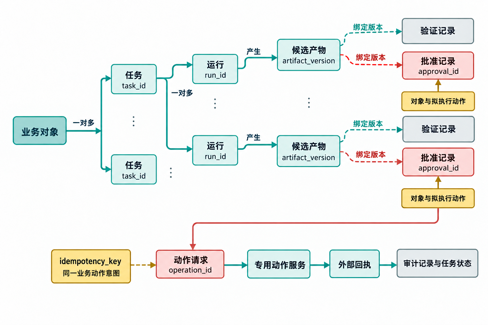

# 附录 D 术语与字段字典

> 原附录 D 全文外移至配套资料（2026-11）；文中章号已按新版调整。

同一个词在模型产品、工作流平台和业务团队中常有不同含义。本附录给出《循环工程》全书用法，并说明它容易与什么混淆。团队可以采用不同名称，但要让状态、权限和审计共享同一语义。各章删去定义段后，本字典是这些术语的统一查询处。

## D.1 核心对象

**模型（Model）**

理解和生成文本、图像、代码或其他内容的能力。模型本身不承担业务任务身份、长期状态和组织授权。产品可能把模型与工具、记忆和运行环境包装在一起，设计时仍要区分哪项能力来自模型，哪项来自外部系统。

**常见混淆**：模型返回"已经发送"，不证明消息服务执行成功；模型知道付款规则，也不表示拥有付款权限。

**Agent**

在目标、上下文、工具和权限范围内，能够选择步骤并执行任务的主体。Agent 可以由一次模型调用、连续会话、脚本和工具组合实现。

**边界**：Agent 负责执行或准备证据，不自动成为业务责任人。一个 Agent 能调用工具，只说明技术入口存在，授权仍由控制面和具名角色决定。

**工作流（Workflow）**

由预先确定的步骤、分支和状态推进任务的系统。部分步骤可以调用 Agent，部分使用规则、应用程序编程接口（API）或人工。

**常见混淆**：动态选择工具不意味着整条业务流程都应动态。身份、权限、动作门禁和停止条件适合保持明确。

**循环（Loop）**

让一类任务持续被发现、交付、验证、记忆和再次调度的工作系统。循环的对象是一项可重复业务任务，不等同于代码中的 `while`，也不等同于在同一会话反复提示。

**完成方式**：一次运行完成后，循环继续存在；循环本身在退役时才结束。

**控制面（Control Plane）**

保存任务状态、版本、策略、预算和权限，决定重试、暂停、转人工和动作放行的系统。控制面可以是表格、数据库、工作流平台或专用服务。

**设计原则**：关键控制尽量可查询、可测试。Agent 可以建议下一状态，不能凭自由文本自行制造审批、扩大权限或删除审计。

**执行面（Execution Plane）**

Agent 实际读取资料、调用工具、修改隔离工作区和生成产物的环境。它可以是本地进程、容器、工作树、浏览器会话或云端沙箱。

**区别**：控制面决定"允许做什么、当前做到哪里"，执行面完成"本次怎样做"。

## D.2 任务身份

**业务对象（Business Object）**

循环处理的现实对象，例如客户会话、订单、发票、项目、选题、Pull Request 或合同。业务对象拥有自己的权威状态和版本。

**任务（Task）**

对某个业务对象执行一种有稳定边界和完成条件的工作。例如"为发票 081 生成第一次到期提醒草稿"。

**任务类型（Task Type）**

一组共享合同、权限和验证方法的任务，例如"首次收款提醒""持续集成（CI）类型错误修复"。任务类型不能宽到"运营 Agent"或"软件工程"。

**任务身份（`task_id`）**

识别同一业务意图的稳定键。它常由业务对象、任务类型、周期或关键版本组成。

```text
invoice_id + reminder_stage + recipient
repo + commit + workflow + job + repair_policy
team + business_week + report_policy
```

`task_id` 过窄会把同一意图创建多次，过宽会把不同工作错误合并。时间戳通常适合 `run_id`，不适合用于任务去重。

上面三行分别是发票提醒、代码修复和周报的身份组合示意，`+` 表示共同参与识别，不要求照抄成字符串拼接代码。选择字段时用重复触发和真实业务变化分别验证：前者仍应找到原任务，后者只有在意图或约定版本边界改变时才创建新任务，不能把三行字段合并成一套通用键。

**运行（Run）**

某项任务的一次执行尝试。环境故障重试、验证退回后的修改和人工重新运行都会产生新的运行记录。

**运行身份（`run_id`）**

标识一次尝试，用于关联模型、工具、命令、费用、产物和结果。同一 `task_id` 可以有多个 `run_id`，历史运行不能被最终成功覆盖。

**动作（Operation / Action）**

改变外部世界或正式业务状态的一次请求，例如发送、发布、付款、退款、删除、创建 PR 和改价。动作有独立 `operation_id`，不能只用运行身份代替。

英文文档中的 `Operation` 与 `Action` 有时都会译为"动作"。全书统一用"动作"描述业务意图，用 `operation_id` 记录这次可追踪的外部请求及其回执；两者不拆成两个字段，也不能用 `run_id` 代替 `operation_id`。

**业务幂等键（Idempotency Key）**

识别同一业务动作意图的稳定键。重复请求带相同键时，动作服务返回已有结果，不产生第二次预期效果。

**注意**：幂等键只防同一意图重复，不能阻止两个不同流程各自创建一笔语义重复的补偿。动作服务还要检查业务对象历史、累计金额和政策。

为发票 081 生成第一次到期提醒草稿，可能因环境故障重试，也可能因验证退回而修改。业务意图没有因此变成多项任务，但每次尝试产生的费用、产物和证据需要分别保留；以后若允许发送，还要知道批准的究竟是哪一版。图 1 将这些对象分开，说明为什么只保存一个"成功"状态或一段最终对话不足以支持查询与恢复。



*图 1 核心对象关系*

图左侧的两个"一对多"处理不同问题。一个业务对象可以对应多项约定好的工作，同一项工作又可以有多次运行；前者用任务身份区分意图，后者用运行身份保留尝试历史。发票提醒的重试因此仍归原任务，不能每次创建新任务，也不能用最后一次成功覆盖前面的失败。中部的版本绑定继续限定验证与批准：旧草稿已经通过，不表示修改后的草稿也已通过；针对旧版本的批准，也不能自动授权新内容。

底部动作链只有在合同允许外部动作且门禁满足时才适用。`operation_id` 关联本次请求，业务幂等键关联同一动作意图，外部回执再提供实际结果；响应丢失时需要沿这条关系查询，不能换一个运行编号后当作新意图重发。若任务只要求内部草稿，就不必为了走完整张图而生成批准和发送请求。图中的连线说明应保存的关系；具体产品是否已经实现这些控制，需要另行核对。后面的五步公式说明由哪些环节维护它们，D.12 再给出字段层面的对应。

## D.3 五步公式

**发现（Discovery）**

从事件、周期扫描或人工入口识别需要处理的工作，创建或更新任务。发现层负责来源认证、任务身份、去重、合并、补漏和初步范围判断。

**不承担**：发现一封客户邮件不等于理解全部意图，也不授权回复或退款。

**交付（Handoff）**

把本次目标、输入、上下文、约束、权限、成功标准和回传方式组成任务包，交给隔离执行环境。

**交付失败**包括资料缺失、权威来源冲突、权限无法签发和执行环境无法建立。它们与模型生成错误分开记录。

**验证（Verification）**

用预先确定的标准和独立证据检查产物或拟执行动作。验证可以组合确定性规则、环境测试、独立 Agent 和人工领域判断。

**不等于自评**：让执行者换一个角色描述评价自己的总结，缺少证据、方法和权限分离。

**记忆（Persistence）**

保存下一轮真正需要的任务状态、事实谱系、决定、反馈候选和方法版本。Persistence 也包含可靠持久化，不只指模型的"长期记忆"功能。

**调度系统（Scheduling）**

负责让任务从触发进入可控执行，决定如何排队、并发、重试、背压、暂停和恢复。下位的调度规则只描述任务何时有资格运行，定时触发也只是调度系统的一种入口。

## D.4 输入与知识

**权威事实（Authoritative Fact）**

由明确业务系统或责任人拥有、可以支持状态和动作判断的数据。例如到账状态由对账系统负责，合同日期由批准合同版本负责。

**外部陈述（External Statement）**

客户、网页、邮件、评论或第三方对事实的描述。它可以触发调查、帮助理解体验，不能未经核对覆盖权威事实或系统政策。

**来源材料（Source Material）**

任务获准使用的文档、记录、网页、数据或媒体。每份材料应有来源主体、版本、读取时间、许可和适用范围。

**证据（Evidence）**

支持某项事实、验证结果或决定的可检查记录。证据可以是原始字段、文档位置、命令退出码、测试结果、动作回执和具名审批。

**质量属性**：来源、范围、版本、新鲜度和独立性。日志很多不代表证据充分。

**上下文（Context）**

本次执行需要看见的任务说明、事实、来源、工具、状态和历史。上下文是工作集，应按用途与权限选择。

**摘要（Summary）**

对原始材料的压缩表示，适合导航和减少成本。摘要会丢限定词、时间和例外，关键判断应保留原始引用。摘要不是新的权威来源。

**偏好（Preference）**

某个个人、客户、项目或团队对表达和工作方式的选择。例如标题格式、语气或通知时间。偏好有作用域、来源和更正入口，不能覆盖事实与政策。

**政策（Policy）**

组织批准、可以约束动作与权限的规则。政策有所有者、版本、适用对象和生效时间。执行 Agent 可以提出政策候选，无权把一次反馈直接变成组织政策。

**Skill**

把某类任务的方法、步骤、约束和工具使用方式封装为可复用资产。Skill 需要来源、版本、权限评审和评测。下载一个 Skill 不等于组织已经授权其脚本和外部服务。

**Combo Skill**

第 6 章使用的 Floatboat 产品对象，简称 Combo，是可以安装并绑定到会话的能力包。包可以组织任务说明及其需要的工具和资源；安装、绑定、实际调用和业务验收是不同步骤。普通 `SKILL.md` 不会因为文件存在就自动成为已安装 Combo，需经过相应导入或制作过程。Combo 也不等于多条工作流的可靠调度器，不能据此推断自动具备依赖等待、失败恢复或权限隔离。功能依据见 `SRC-FB-002`。

**Automation 与 Workflow 触发绑定**

第 5 章涉及的两类产品对象。Automation 保存供 Agent 执行的任务目标与日程；Workflow 触发绑定为既有工作流指定触发条件。两者有各自的标识、配置和生命周期，操作入口不能互换。产品返回的任务、绑定或运行标识应保留原类别，不直接替代按业务事实定义的 `task_id`、`run_id`；需要关联时另行保存映射。功能依据见 `SRC-FB-001`。

**Floatboat Workflow**

第 8 章使用的可执行流程对象，把已经明确的步骤保存为程序，由宿主直接执行。它可以按自然语言要求创建，也可以从已完成任务的会话中整理出来；保存流程与建立定时或事件触发是不同动作。不调用模型的固定步骤执行不消耗模型 token，但创建和修改的对话、流程内显式调用 Agent 或其他模型服务的步骤需要单独计入模型用量，工具及付费流程还可能有其他费用。Combo 和 Workflow 都可以复用会话成果，区别在于需要复用的是供 Agent 使用的方法，还是可直接执行的固定步骤。依据见 `SRC-FB-004`，不能将这一区别理解为所有 Combo 都必须调用模型或所有 Workflow 都没有模型调用。

**工作台（Workbench）**

第 6 章用于集中查看经营记录的应用形式，包括需要实现的页面、数据处理和存储。练习使用的模板为 [floatboatai/floatboat-workbench-template](https://github.com/floatboatai/floatboat-workbench-template)，取得方式与版本核对见第 6 章。Floatboat 工作台工程提供开发与运行的基础，创建工程不等于业务应用已经完成；一个看板也不会自动成为保存政策、控制权限和协调多个循环的控制面。第 9 章需要另行设计这些责任，不能由页面外观推断其存在。功能依据见 `SRC-FB-003`。

## D.5 结果与状态

**产物（Artifact）**

一次运行生成的草稿、补丁、报告、建议、结构化数据或其他输出。产物有版本或哈希，验证与审批绑定具体版本。

**候选（Candidate）**

系统发现的可能任务、事实、规则或内容，尚未满足执行或正式使用条件。候选存在并不表示已经接受。

**草稿（Draft）**

位于安全交付区、未产生正式外部承诺的产物。草稿可以由人修改，修改后形成新版本并重新应用必要验证。

**通过（Passed）**

产物满足某个版本验证策略。通过不自动表示动作有权发生；还可能需要当前事实、审批、预算与动作门禁。

**批准（Approved）**

具备相应权限的人对具体对象、版本、动作和有效期作出同意。内容、收件人、金额或关键事实变化会使批准失效。

**已提交（Submitted）**

动作请求已被外部系统接收，最终业务结果尚未确认。异步付款、部署和消息队列常需要这一状态。

**完成（Completed）**

任务的业务完成条件已经满足并有证据。例如 PR 已创建可能是修复任务完成，也可能仍需部署观察，取决于合同。技术调用成功不能自行定义完成。

**动作状态未知（`action_status_unknown`）**

通信失败导致系统无法确认外部动作是否发生。全书机器字段唯一使用 `action_status_unknown`；`status_unknown` 不是允许的别名。该状态禁止普通重试，先用动作 ID、幂等键或外部对象查询。

**范围外（`out_of_scope`）**

任务不属于当前循环合同，系统说明原因和应转交的角色。范围外是正确结果，不应算模型失败或强行处理。

**永久失败（`failed_permanent`）**

输入无效、权限拒绝、政策禁止或超过有效期等问题，重复相同运行无法解决。需要修输入、改变授权、作出业务决定或结束任务。

**暂停（Paused）**

循环或某类动作暂时停止推进，同时保留任务、信号和证据。暂停有范围、原因和恢复权。

**取消（Cancelled）**

某项任务因业务意图撤回、基线过期或已由其他路径完成而终止。取消不会删除历史动作。

**退役（Retired）**

循环停止接收新任务，处理在途与消费者，撤销权限并按政策处理数据。退役是一项正式变更，不是长期暂停的别名。

## D.6 验证与人工

**确定性检查（Deterministic Check）**

同样输入和规则应产生稳定结果的检查，例如模式定义（Schema）、数值复算、版本、权限、唯一约束、单元测试和内容哈希。确定性只保证同样输入得到同样结果，来源正确性仍要靠绑定权威输入来确认。

**语义验证（Semantic Verification）**

判断事实表达、需求覆盖、论证、语气或代码行为等无法完全写成固定规则的问题。它需要具体标准、代表性样本和证据，不能依赖"看起来不错"的总分。

**独立验证（Independent Verification）**

验证者从原始证据、不同方法或独立权限边界检查执行结果。独立性来自证据、方法、上下文和权限分离，未必要求不同模型厂商。

**人在回路（Human-in-the-Loop）**

人在风险门禁、例外处理或规则治理位置作出明确决定。人的存在应改变任务状态，并获得足以判断的证据。

**人工接手（Human Handoff）**

Agent 因范围、权限、预算或无进展停止，将任务与证据交给有责任的人。接手包应减少重新调查，不隐瞒失败尝试。

**人工覆盖（Override）**

人基于领域判断改变系统建议或验证结果。覆盖需要理由和作用域，它是改进信号，也可能暴露政策冲突。覆盖数量过低可能因为入口太难，不自动表示系统正确。

**审批疲劳（Approval Fatigue）**

人工队列超过判断容量后，人快速批量通过或只看表面。它表现为决定时间骤降、批量通过增加和审批后错误。解决方式是上游降速、确定性预检和缩小人工范围。

**验证债务（Verification Debt）**

自动产出增长快于检查能力，未验证或低质量验证逐渐累积。偿还方式包括限制吞吐、增加确定性检查、更新样本、风险抽样和调整人工容量。

## D.7 权限与安全

**最小权限（Least Privilege）**

主体只获得完成当前任务所需的资源、动作、条件和时限。它包含对象级范围与数据用途限制，不能简化为"只读就是安全"。

**服务身份（Service Identity）**

循环长期读取、计算或写草稿使用的专用身份。服务身份与个人审批分开，也按任务类型拆权限，不能成为万能机器人账号。

**临时授权（Temporary Grant）**

为具体任务、班次或事故签发的带范围和到期时间的权限。使用和撤销都进入审计。

**破窗授权（Break-glass Access）**

事故中用于暂停、调查或恢复的紧急高权限路径。它绑定事件、自动到期、全面记录，并在事后由未参与使用的人复核。

**沙箱（Sandbox）**

限制执行环境能够访问的文件、网络、进程和系统资源。沙箱减少影响半径，不能替代业务权限、短期凭证和外部动作门禁。

**数据用途限制（Purpose Limitation）**

数据可以为哪些任务和处理方式使用。组织拥有或用户能打开一份数据，不代表它可以被送到任意模型、用于绩效判断或永久写入记忆。

**租户隔离（Tenant Isolation）**

不同客户、组织或安全域的数据在检索、缓存、索引、日志和评测中保持分离。隔离要在访问前生效，不能依赖模型输出时自行过滤。

**提示注入（Prompt Injection）**

不可信内容包含试图改变 Agent 指令、工具或数据范围的文本。控制方式包括指令与数据分离、最小权限、工具限制、来源与用途标签、验证和动作门禁。让模型回答"我会忽略"不构成工具层防护。

**副作用（Side Effect）**

改变外部世界或正式状态的动作。可撤销性、对象数量、资金、敏感性和公开程度决定门禁强度。写个人草稿和批量发送即使都叫"写"，风险不同。

## D.8 调度与可靠性

**触发（Trigger）**

可能创建或唤醒任务的事件、周期或人工动作。触发只提供信号，任务执行前仍要读取当前权威状态。

**调度规则（Schedule）**

描述任务何时有资格运行的时间或事件规则。调度规则由上位的调度系统执行，还受队列、预算、依赖和业务日历约束。

**队列（Queue）**

保存等待执行、验证、人工或动作的任务。队列要观察进入量、完成量、积压、最老等待和预计清空时间。

**租约（Lease）**

某个执行者在有限时间内处理任务或业务对象的权利。租约过期允许接管，原执行者必须在动作前重新确认，避免两个运行同时写入。

**重试（Retry）**

在同一业务任务下创建新运行，处理被分类为瞬时的失败。重试有最大次数、总时限、费用和无进展条件。

**退避（Backoff）**

失败后逐步延长再次尝试间隔，减少对故障服务的压力。抖动用于避免大量任务同时醒来。认证、参数、权限和政策失败不因退避变得可重试。

**背压（Backpressure）**

下游容量不足时，向上游传递减速信号。验证积压时减少生成，人工满载时暂停低优先级任务，不能继续展开昂贵中间产物。

**熔断（Circuit Breaker）**

同类严重错误、外部故障、费用或状态未知超过阈值后，自动暂停相关调用或动作。熔断保留证据并定义探测与恢复，不等于永久关闭。

**恢复（Recovery）**

故障修复后，根据当前事实处理积压、旧产物和在途动作，先小批运行再扩大。拨回开关不会自动清理积压和在途动作。

**补偿（Compensation）**

对已经发生、无法技术回滚的业务动作进行后续修复，例如澄清消息、账务调整、取消采购或客户补偿。补偿有责任人、窗口和证据。

**无进展（No Progress）**

多次运行没有产生新证据，补丁来回切换，或相同失败重复出现。达到阈值后停止并接手，不能把持续消耗当坚持。

## D.9 观测与治理

**日志（Log）**

运行过程中产生的事件记录。日志用于调查，需要任务、运行、对象、版本和动作关联；敏感内容按用途遮蔽与分层访问。

**审计记录（Audit Trail）**

能够说明谁在何时依据什么版本和权限作出何种动作的记录。审计记录比普通调试日志保留更稳定，不应被后来规则改写。

**指标（Metric）**

对输入、结果、质量、风险、容量和成本的量化观察。指标有分母、窗口和口径。单一总分不能同时表示事实正确、业务允许和系统可靠。

**告警（Alert）**

需要人或系统采取动作的异常信号。告警包含影响、当前状态、自动处置、负责人和建议，不重复发送无人能处理的通知。

**近失（Near Miss）**

错误已经进入控制链，但在造成外部影响前被拦截，或偶然未造成损失。近失能测试控制是否有效，不能因"最终没事"忽略。

**事故（Incident）**

循环造成或可能造成显著业务、安全、数据、资金或客户影响，需要正式响应、范围确认、遏制、恢复和复盘的事件。是否由 AI 直接生成不是事件分级依据。

**变更（Change）**

模型、提示、Skill、数据源、权限、验证、动作范围和状态语义的修改。变更说明影响、证据、灰度、停止与回滚，并保留旧任务使用的历史版本。

**影子运行（Shadow Run）**

读取真实或代表性信号，生成候选结果但不改变正式状态。用于比较新旧执行器、规则和路由。影子环境仍需保护数据和费用。

**灰度（Canary / Gradual Rollout）**

先向少量低风险对象开放变更，观察质量、业务和系统指标后扩大。灰度单位可以是租户、任务类型、地区或流量比例。

其中，`Canary` 强调先选择少量低风险对象进行对照；`Gradual Rollout` 强调按阶段扩大覆盖范围。全书把两者都归入"灰度"，但实施记录仍要写明灰度单位、观察窗口、扩大门槛和停止条件。

**回滚（Rollback）**

恢复旧模型、规则、配置或软件版本。回滚不能撤销已经发生的消息、付款和公开发布，这些需要业务补偿。

**循环目录（Loop Registry）**

组织保存生产与试验循环的负责人、数据、供应商、权限、动作、依赖、预算、评测、事件和退役信息。它用于影响分析和治理，不是自动化成果陈列。完整登记字段见[附录 A.18 组织循环目录条目](A_工具箱/A18_组织循环目录条目.md)。

**连接合同（Connection Contract）**

两条循环之间事件、状态或动作接口的业务约定，包含身份、版本、顺序、重复、撤回、敏感字段和消费者。格式兼容之外还要维护语义兼容。

## D.10 价值与成本

**人工基线（Manual Baseline）**

自动化前真实工作的准备、判断、执行、等待、返工、质量和成本。基线使用代表性任务与口径，不用理想流程估算。

**单位成本（Unit Cost）**

每项成功业务任务的模型、工具、计算、存储、人工、维护和事故成本。分母是符合成功定义的任务，不是调用次数或生成字数。

**直接成本（Direct Cost）**

可归到具体任务或循环的调用、工具、计算和人工时间。

**共享成本（Shared Cost）**

多个循环共同使用的平台、监控、安全、浏览器池和治理成本。按使用量、风险或预算中心分摊，保持口径足以支持决定。

**边际成本（Marginal Cost）**

再处理一批任务增加的成本。容量接近上限后，新增任务可能触发更贵模型、外部限流或额外审批班次，边际成本会出现阶跃。

**预算（Budget）**

单运行、任务、周期或组织允许的时间、调用、工具、金额和人工容量。预算耗尽后的降级、暂停和追加权由预先政策决定。

**消费者（Consumer）**

真正读取产物并作出后续动作的人或系统。没有消费者的稳定生成只是在制造库存。

**采用（Adoption）**

使用者在实际工作中接受、修改或拒绝循环结果。登录和调用次数不能单独证明采用价值；还要看业务完成、人工负担和风险。

**退役条件（Retirement Condition）**

循环停止的业务或工程信号，例如任务取消、长期无人消费、重复于其他系统、全成本超过价值、风险无法控制或负责人缺失。

## D.11 成熟度等级

L0 至 L4 的完整定义、八维评分表、硬门槛与证据分级，见配套的[循环成熟度自测表](../self-assessment/循环成熟度自测表.md)；以下是各级的一句话索引。

**L0：手工问答**

任务由人临时启动，输入和检查主要依赖个人。适合低频、探索和目标不稳定的工作。

**L1：可复用辅助**

任务卡、模板和样本开始稳定，结果停在草稿或建议，通常由人启动并承担关键检查。自动触发本身不说明控制是否齐备；整体等级仍按自测表八个维度的最低项判断。

**L2：受控循环**

任务有稳定身份与状态，自动发现或调度，使用受限权限、独立验证、预算、暂停和人工退路。许多业务长期停在 L2 已经合适。

**L3：规模化运行**

多对象、多团队或较高频率运行，具备容量、背压、值班、版本治理、故障演练和跨循环协调。

**L4：组织治理与持续改进**

循环进入组织目录、风险与变更流程，证据支持扩张和收缩，供应商、人员、申诉、成本和退役均有正式责任。

成熟度描述控制能力，不描述 Agent 自主程度。L4 组织可以让付款循环永远保持建议加双人批准。

## D.12 推荐最小字段集

第一次实现任务表时，容易把所有编号、版本和结果放在同一行，再用最新值覆盖旧值。创建工单若遇到响应丢失，这样的记录可能只剩"最近运行失败"，无法查出请求是否发出，更无法关联外部已经创建的工单。下面的字段字典把字段的来源、必填时机与用途一起列出，用于保留这种查询能力。它是建议的最小语义合同，不是某个数据库产品的完整模式；实际存储仍按任务、运行和动作分层。

| 字段 | 类型或单位 | 何时必填 | 来源与关联 | 用途与边界 |
| --- | --- | --- | --- | --- |
| `task_id` | 稳定字符串键 | 创建任务时必填，后续不变 | 由发现层生成；运行表和动作表用 `task_id` 关联 | 识别同一业务意图；不能用时间戳或 `run_id` 代替，也不能把不同意图合并 |
| `task_type` | 受控字符串或枚举 | 创建任务前必填 | 来自任务合同目录，关联权限和验证策略 | 选择合同、权限和验证；不能宽泛写成"运营 Agent"或"软件工程" |
| `business_object_id` | 业务系统中的字符串键 | 任务针对业务对象时必填；无对象时须记录适用范围 | 来自业务对象的权威系统，关联对象版本和状态 | 关联客户、订单、项目等对象；不等于对象当前状态，也不能用摘要代替 |
| `input_version` | 字符串、序号或内容哈希 | 输入可能变化时必填；验证或动作前必须可核对 | 来自来源系统或输入快照，关联 `artifact_version` | 判断结果是否过期；不能把读取时间冒充来源版本 |
| `state` | 受控状态枚举 | 每次持久化任务都必填 | 由控制面写入，关联状态转移证据 | 表示当前流程位置；候选、草稿、通过、已提交、完成、暂停、取消、范围外和永久失败等状态须按合同区分，不能仅凭模型文本改变 |
| `owner` | 具名用户、角色或服务身份标识 | 进入待处理、待审批、人工接手或升级状态时必填 | 来自控制面或责任矩阵，关联决定和交接记录 | 指向实际责任主体；不能写成"系统"或让 Agent 自任最终问责人 |
| `created_at` | 带时区时间戳 | 创建任务时必填 | 由控制面记录，作为队列和审计起点 | 表示任务进入系统的时间；不是截止时间，也不是运行开始时间 |
| `due_at` | 日期或带时区时间；无值时记录原因 | 合同有截止或服务等级时必填 | 来自任务合同和业务日历，供调度与升级使用；含时分秒的来源先按业务时区归一化 | 表示应完成或应升级的时点；不能用 `created_at` 或预计完成时间代替 |
| `policy_version` | 策略版本字符串 | 发生权限、动作、保留或风险决定时必填 | 来自策略目录，关联审批和审计记录 | 还原当时适用规则；不能只读取当前最新策略 |
| `risk_level` | 项目定义的受控枚举 | 放行权限、外部动作或优先级前必填 | 来自风险评估并受政策约束，关联门禁 | 选择权限、门禁和优先级；不是错误严重度（严重度 S0–S4 见[附录 E.5](E_评测样本库/README.md)），也不能用自由文本绕过门禁 |
| `latest_run_id` | `run_id` 字符串，或未运行时的带原因空值 | 至少一次运行完成后必填 | 由控制面指向运行表；历史运行仍单独保存 | 快速进入最新运行证据；不能覆盖历史或把它当成任务身份 |
| `artifact_version` | 版本字符串或内容哈希 | 产生需要验证、批准或消费的产物时必填 | 来自产物存储，关联验证记录和审批记录 | 绑定被检查的确切版本；不能只记录模型版本或文件名 |
| `verification_result` | 受控结果枚举 | 发生外部动作前必填；未验证时明确为空并说明原因 | 来自验证记录，关联 `artifact_version` 和验证策略版本 | 区分通过、退回、转人工和系统错误；不等同于批准或任务完成 |
| `approval_id` | 审批记录字符串，或不适用时带原因空值 | 任务合同要求具名审批的动作前必填 | 来自审批服务，关联对象、产物、动作、审批人和有效期 | 绑定具名决定及其期限；自由文本"已同意"不能替代审批记录 |
| `operation_id` | 动作请求字符串 | 外部副作用请求发出前生成并持久化，已尝试、状态未知及查询期间持续保留 | 由动作请求方或动作服务预先分配并写入动作表；外部回执另以 `external_id` 关联 | 关联一次外部副作用；不能与 `run_id` 混用或跨动作复用 |
| `idempotency_key` | 不透明字符串键 | 可重试的外部动作发出前必填 | 由动作服务按业务意图生成，关联重复请求结果 | 防止同一意图重复生效；不能阻止不同流程产生语义重复 |
| `cost_total` | 十进制金额，必须带币种 | 任务完成或周期结算时必填；中途可标记为估算 | 由运行、工具、人工和事故成本记录汇总 | 支持单任务归因；不能把调用次数、字数或未标币种金额当作单位成本 |

以创建工单为例，发请求前先持久化 `operation_id` 及其 `task_id` 关联，即使响应丢失，也能按原请求查询和对账。外部系统返回的工单编号另存为 `external_id`；它与本地动作身份相关联，却不能代替发出请求前就应存在的记录。如果只有拿到回执才记录动作，最需要排查的超时请求反而会从账本中消失。

表中"何时必填"与"来源与关联"要一起检查。任务刚创建时可能没有产物，产生草稿后应保存确切的 `artifact_version`，未验证时明确标记；验证发生后，再关联针对该版本的记录。合同要求批准时，还要找到绑定该版本与动作的 `approval_id`。暂不适用的字段可以说明原因，当前阶段应有却缺失的字段则意味着不能继续推进，不能用模型解释补成"已完成"。输入版本、产物版本和政策版本也各自回答不同问题，记录一个模型版本无法替代它们。

实现时可以调整字段名、类型细节或枚举，但要保留这些关联和状态条件。`latest_run_id` 只是进入最新证据的入口，不能使此前运行消失；同理，动作状态要由外部查询与回执支持，不能被最新一次运行的失败覆盖。下面的运行表保存每次尝试，动作表保存外部请求与结果，两者共同支持任务表的当前状态：

```text
run_id, task_id, start_at, end_at, executor_version,
environment_version, permission_scope, result, error_class,
artifact_version, verification_version, cost, evidence_uri
```

运行表中的 `start_at` 和 `end_at` 都是带时区时间戳；`permission_scope` 是受控的资源与动作集合；`cost` 必须带币种和计量口径；`evidence_uri` 必须能定位到保留期限内的证据。`result` 与 `error_class` 描述一次尝试，不得直接覆盖任务表的 `state`，也不能把最新运行当成唯一历史。

动作表另存：

```text
operation_id, task_id, action_type, target, content_or_amount_hash,
approval_id, policy_version, idempotency_key, requested_at,
external_id, status, confirmed_at, compensation_status
```

动作表中的 `requested_at` 和 `confirmed_at` 是带时区时间戳；`content_or_amount_hash` 只保存用于比对的哈希，不将原始敏感内容写入动作表；`status` 至少要能区分已请求、已提交、已确认和状态未知，具体枚举由本地模式定义。只有外部系统确认后才填写 `confirmed_at`；不可技术回滚的动作还要保留 `compensation_status`，不能用"调用成功"代替业务结果。

字段名称可以调整，关系不能丢。实现验收要能从 `task_id` 进入运行与动作记录，识别哪些字段在各状态必填。如果将所有信息只放在一段对话摘要中，去重、查询、审计和恢复就会依赖模型重新解释。

## D.13 三组最容易混用的词

下面三组词分别回答三个不同问题：一次调用发生了什么，产物或动作是否满足门槛，以及任务或循环是否可以结束或继续。先按证据所在层次分类，再决定能否重试、放行、接手或退役；不要把相邻词压缩成一个布尔开关。

**"成功、通过、完成"**

- **调用成功**：工具或应用程序编程接口（API）接受请求并返回技术层响应；它只证明入口处理，不证明外部业务状态已经改变。
- **验证通过**：产物按指定版本的验证策略和证据检查达到标准；它不自动授予执行外部动作的权限。
- **动作成功**：外部系统确认目标状态已经改变，并能用 `operation_id`、外部对象标识或回执核对；请求已接收但尚未确认时不能写成动作成功。
- **任务完成**：业务合同的完成条件已经满足并有证据；即使动作成功，仍可能因等待观察、补偿或后续验证而未完成。
- **循环健康**：循环在约定的质量、风险、容量和成本边界内持续运行；这是周期性治理判断，不是某一次运行的状态。

因此，技术调用、验证、外部动作、业务任务和持续运行分别保留自己的证据与状态，不能互相替代。

**"失败、拒绝、等待"**

- **系统失败**：执行环境或工具无法完成本次尝试；先保存错误类别和证据，再按瞬时性判断是否允许新运行。
- **验证退回**：产物不符合当前标准，但缺口可以定向修订；修订后必须生成新版本并重新验证。
- **权限拒绝**：当前主体没有执行该动作所需的授权；重复同一运行不会改善，必须改变授权或转交责任人。
- **政策禁止**：适用政策明确不允许该动作；不能靠换模型、换提示或退避绕过，必要时将任务标记为永久失败或范围外。
- **等待**：依赖、资料或具名决定尚未到达；保留等待对象、截止时间和升级出口，不把等待写成失败。
- **范围外**：任务不属于当前循环合同，应转交其他任务或具名角色；这不是模型质量失败，也不应强行处理。

只有被分类为可重试的系统失败才进入重试；权限拒绝、政策禁止和范围外必须先改变边界或责任。

**"暂停、降级、取消、退役"**

- **暂停**保留原任务或循环范围，暂时停止推进并等待修复或决定；恢复前要核对状态、证据和恢复权，不得当作已取消。
- **降级**是在更窄权限、更低频率、更小对象范围或更早的自动化权限阶段继续服务；降级必须标记不完整结果和后续恢复条件。
- **取消**结束一项具体任务，原因可以是业务意图撤回、基线过期或其他路径已经完成；取消不会删除历史动作。
- **退役**永久关闭一条循环，停止接收新任务、处理在途与消费者、撤销权限并按政策处理数据；它不是长期暂停的别名。

这四种状态改变的对象、可恢复性和责任不同；若全部实现成一个开关，恢复和审计都会失去边界。

## D.14 为团队建立共同语言

选一项真实任务，让业务、技术和风险人员分别解释"完成""批准""重试"和"负责人"。把差异写下来，再用本字典或组织自己的定义统一。共同语言应落到字段、状态和动作服务中，不只停在术语表。

每次事故、跨部门交接和供应商迁移都会暴露新的语义冲突。团队可以增加术语，但先问它是否对应新的责任、证据或状态。两个词若无法改变任何处理方式，保留清楚的那个。
