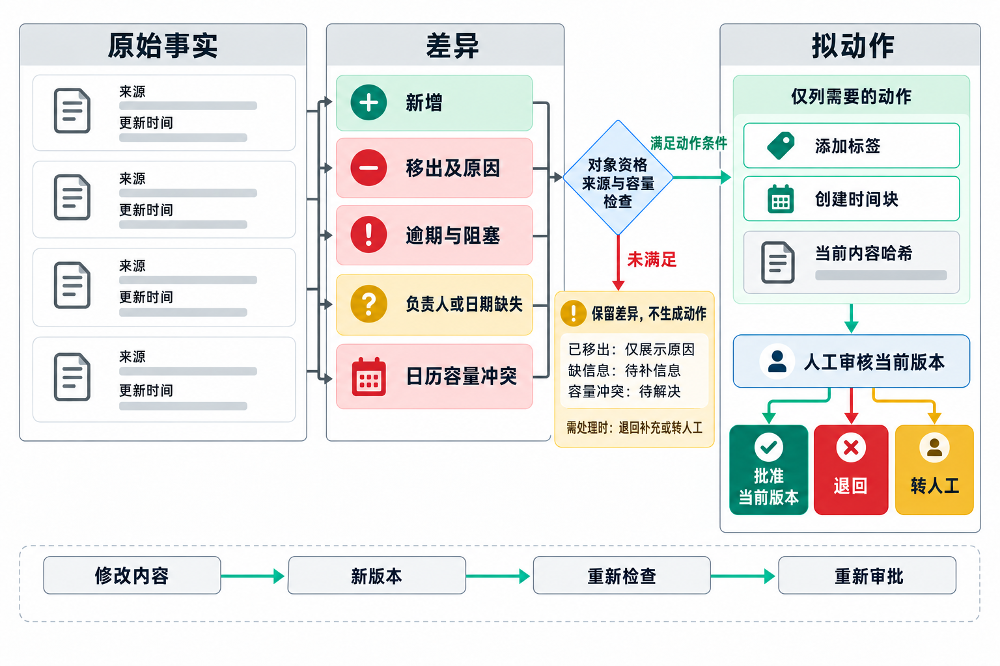

# 审批界面的差异区域与必备内容

> 编号说明：本文件由原第 6 章外移，保留原稿表号与小节号（表 6-x 对应新版正文表 5-x；6.x 对应新版 5.x）。

刚搭建循环时，人们常常直接把完整结果发给审批人。这样一来，审批人仍需重新阅读全部输入，工作量并没有明显下降。因此，审批界面应突出作决定所需的信息，减少反复查找和核对的时间。

每日待办摘要中，一项任务今天消失，可能是已完成、已取消，也可能是被流程遗漏。审批人需要看到这个差别，才能判断该接受摘要还是退回检查。表 6-11 按新增、移出、风险、冲突、拟动作和来源组织材料，让人先定位变化，再回查相应证据，减少在整份清单中反复寻找。

**表 6-11  每日待办审批界面的差异区域与必备内容**

| 区域 | 内容 |
|------|------|
| 新增 | 相比昨天新进入今日清单的任务 |
| 移出 | 完成、取消、等待或重新排期的任务与原因 |
| 风险 | 逾期、阻塞、负责人和日期缺失 |
| 冲突 | 任务计划与日历容量冲突 |
| 拟动作 | 将添加哪些标签或时间块 |
| 来源 | 每项任务链接和更新时间 |

这些区域要关联到同一任务，不能各自成为一份互不相干的列表。某任务出现在“移出”区时，审批人应同时查看原因和来源更新时间，确认它确已完成、取消或转为等待；若“新增”任务又出现在“冲突”区，就要先决定如何安排可用时间，再审查“拟动作”中的时间块。没有理由和来源的移出，仍须按可能遗漏处理。

差异视图不能代替完整性检查。它主要帮助人定位要核对的条目，来源仍需可访问，未变化的任务也仍受覆盖与事实规则检查。第一版只读摘要没有拟执行的外部动作，不应为了填满区域而生成标签或日历操作；扩展了这些动作后，批准才需要同时确认具体对象与影响。人工修改产生新版本后，检查和批准都要跟着更新。

拒绝时也要按类别记录原因。审批人从事实错误、遗漏、优先级、数据过期、权限不当、当前不需要或其他原因中选择，系统才能判断该调整输入、任务包、验证规则还是业务范围。

审批人已经看过草稿，又改了任务安排时，执行步骤还可能拿着先前的批准。图 6-2 将原始事实、差异、拟动作和版本放在一起，用来说明哪些变化能形成动作候选，以及批准究竟对应哪份材料。表 6-11 中的各类差异先汇入对象资格、来源与容量检查，满足动作条件的对象才进入拟动作区。已取消任务只保留移出原因；负责人或日期缺失先补信息，容量冲突未决则先处理冲突，这些条目都不能直接生成新增标签或时间块。

*图 6-2 审批包的差异与版本绑定*

阅读图时，先从来源核对差异，再看条件检查的两个出口。未满足条件的对象留在“保留差异，不生成动作”区，需要处理时退回补充或转人工；满足条件也只是可以提出候选。右侧将拟动作与当前内容哈希一起交给人工审核，审批人仍可选择批准当前版本、退回或转人工，资格检查通过后仍要人工同意。图底部的路径处理审批后的修改：哪怕只是调整了一个时间块，批准对象已经改变，也要生成新版本、重新检查并重新审批。否则，界面上批准的是原安排，实际执行的却是改后的安排。

版本绑定只能确认“批准与候选是否一致”，不能证明候选正确，更不能撤销已经执行的动作。它仍需前面的来源、覆盖和权限检查配合；动作已经发生时，则要依靠变更记录核对影响。下一节错加标签后的回滚和人工接管演练，就从这个边界继续，区分停止新动作与修复已有变更。
