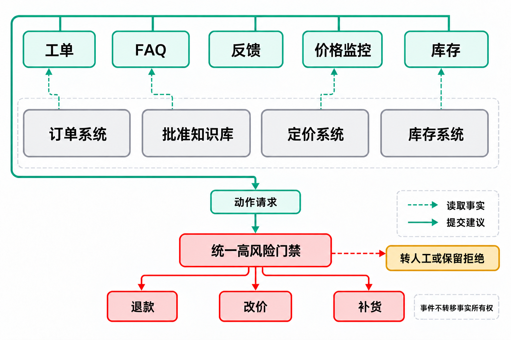

# 客服与电商：五条循环怎样共享状态（事件清单与图 10-1）

> 《循环工程》配套资料（ch06 业务场景循环）。来源：原第 10 章 10.8 节；跨循环事件由新版6.5 节覆盖，类型化事件清单在此保留。图 10-1 一并移入本文件；若后续新版6.5 节需要引为案例，可再迁移至 ch09 目录。

## 10.8 五条循环怎样共享状态

客服与电商循环通过类型化事件共享信号。生产者是写入事件的一方，消费者是读取事件并采取后续动作的人或系统。每类事件都要明确由谁产生、由谁处理，接收方可以写入哪些内容，以及不能据此得出哪些结论。

- **“大量客户未收到”信号**由工单预处理循环产生，供反馈与物流调查任务使用；接收方只能据此创建调查事件、列出可能受影响的订单，不能直接将仓库状态改记为物流事故。
- **FAQ 搜索失败信号**来自客服搜索记录，由知识维护循环处理；接收方只能增加知识缺口候选及其样本计数，不能直接发布新答案。
- **质量问题信号**由反馈处理流程产生，供库存隔离与采购复核任务使用；接收方只能提交待核对的商品批次和风险证据，不能自行下架、报损或修改可售量。
- **竞品价格变化信号**由价格监控循环产生，供经营分析使用；接收方只能保存可比性条件和观察到的变化，不能直接修改本方价格或客服话术。
- **库存不足信号**由库存系统产生，供客服与商品页任务使用；接收方只能据此缩小当前可承诺的发货范围，不能把预测值当成确定的到货日期。

共享事件不会转移事实所有权。订单状态仍以订单系统为准，获批答案以知识库为准，可售库存以库存系统为准，本方价格以定价系统为准。消费者只能通过受控接口提交建议；提交失败时，应保留原事件和拒绝原因，不能自行在几个台账中补写结论。

“大量客户未收到”的信号可以同时进入客服、反馈和库存调查，但不能让三个循环各自改订单、退款或补货。图 10-1 把读取事实和申请动作分成两种路径，说明多条循环如何围绕同一问题协作，而不把一个尚待核查的信号扩散成多项正式操作。

*图 10-1 客服与电商的共享事实和动作门禁*

虚线从权威系统指向使用它的循环，表示查询依据；实线汇入动作请求，表示建议还要经过放行判断。以配送投诉为例，工单循环可以读取订单、反馈循环可以组织调查，但投诉数量不能直接证明缺货，也不能授予退款权。门禁拒绝后保留原因或转人工，不能换一条循环重新提交，以绕过原来的限制。

图中统一的是高风险动作的核对与审计要求；每个审批人只拥有自己的权限范围。退款、改价、补货各有事实来源和责任人；新版 6.6 据此分设资金、库存与价格等门禁。接收事件不会改变这些归属，循环必须通过相应入口更新业务状态。
