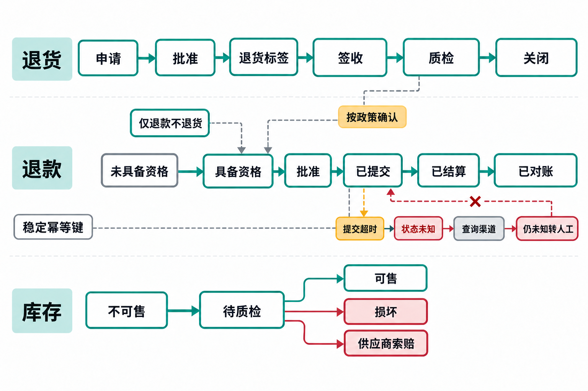

# 退货与退款：钱和货是两条状态链（落选模板，含图 10-2）

> 《循环工程》配套资料（ch06 业务场景循环）。来源：原第 10 章 10.17 节；两条状态链很有价值，但独立成模板会超出新版 6 章预算，全文与图 10-2 在此保留。

## 10.17 退货与退款：钱和货是两条状态链

电商团队常把“退款完成”和“退货完成”当成同一件事。实际上，客户寄回商品、仓库签收、质检、重新入库、支付退款和财务对账由不同系统处理。如果只用一个 `returned=true` 字段记录整个过程，自动化就可能在证据不全时将商品恢复为可售状态，或执行退款。

至少应分别记录以下状态链：

```text
return_request: requested → approved → label_issued → received → inspected → closed
refund: not_eligible → eligible → approved → submitted → settled → reconciled
inventory: unavailable → inspection_hold → sellable / damaged / supplier_claim
```

不同状态链之间可以按规则触发后续步骤，但不要求同步推进。例如，低价商品按政策可以“仅退款、不退货”；高风险商品必须经过仓库质检后才具备退款资格；退款状态到达 `submitted` 只表示支付渠道已受理提交，客户收到退款要等渠道结算；仓库签收商品后，商品仍要经过质检才能重新销售。

**重复退款事故**

一次退款调用超时，支付系统已经受理，但任务的本地状态仍停在 `approved`。五分钟后，系统重试，又提交了一次退款。若动作没有稳定的幂等键，客户可能收到两笔退款。

退款动作服务应在发出请求前，为这一次退款意图生成并保存跨重试稳定的退款请求 ID，用“订单 + 退款请求 ID”组成业务幂等键，同时把退款类型、批准金额、政策版本和订单版本作为提交时必须核对的绑定参数，并保存支付渠道请求 ID。同一订单的第二笔合法部分退款是另一项意图，须使用新的退款请求 ID，不能沿用同一个键。超时后按原键和已保存的支付渠道请求 ID 查询执行结果；仍无法确认时，转入人工队列。对账循环随后核对内部退款记录、渠道流水和客户应收款项，发现差异时创建异常任务，不能自动从客户账户扣回。

防重复只解决“同一意图提交两次”，还要防止两个不同意图重复赔付。同一订单可能同时有物流补偿、客服手工退款和退货退款。动作门禁在订单层计算累计金额和历史补偿，超过政策范围需要具名批准。

**质检输入不应直接控制退款**

仓库备注可能写着“包装像被换过，拒退”。这是需要调查的信号，不能据此认定欺诈。模型可以把照片说明和备注整理成结构化信息，标出缺少哪些证据；政策引擎根据商品、时间、原因和地区作出判断；有争议的案例交给有授权的人处理。若让生成回复的 Agent 同时认定欺诈、拒绝退款并发送消息，就把事实判断、政策适用和客户沟通都交给了同一个执行者。

前面的退款调用超时例子，只能说明支付动作的结果尚待查询，无法据此判断商品是否已退回或通过质检。若用一个“退货完成”标志统管全过程，客服既可能重复退钱，也可能把未检商品记回可售。图 10-2 并列呈现三条状态链，用来判断每一步究竟缺哪一方的确认。



*图 10-2 退货、退款与库存的状态关联*

上方质检结果通过政策判断影响退款资格，随后仍要经过批准与提交；“仅退款不退货”分支也说明退款不总以收货为前提。下方库存则要区分可售、损坏和供应商索赔，不能因钱已退就认定商品可再次销售。各链可以关联证据，但各自的完成状态必须由对应系统确认。

中间的超时分支尤其关系到重复退款：提交结果未知时，要按原键和已保存的支付渠道请求 ID 查询渠道，仍未知就转人工，不能回到“已提交”再做一次。支付已结算也还需要对账，单个退款幂等则不能代替订单层累计补偿检查。下一班接手时，应看到分别待查的支付和货物状态，“退货处理中”这类笼统表述不足以交接。
