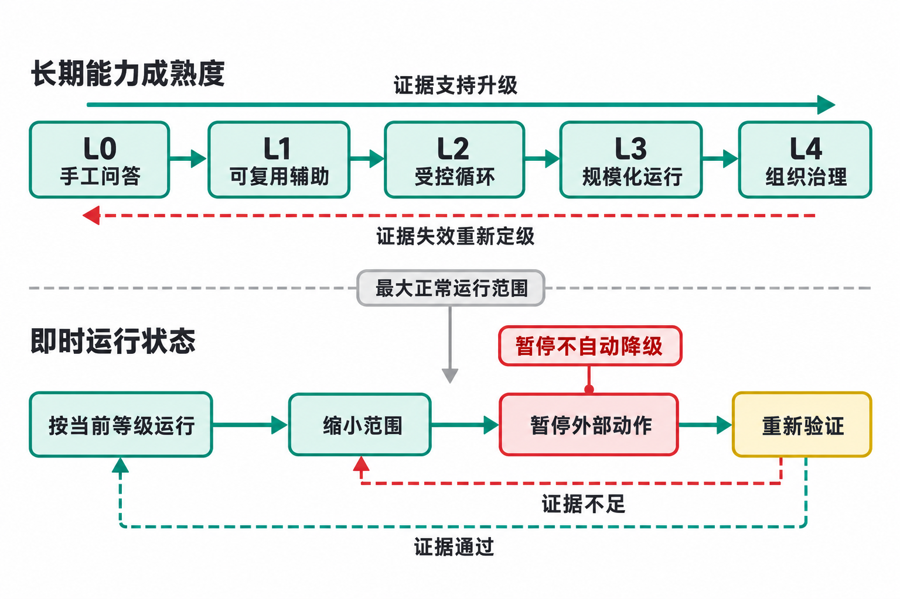

# 循环成熟度自测表

> 原第 16 章《循环成熟度自测》全文改版外移至配套资料（2026-11），由一章改为一套自测工具；文中章号已按新版调整，三个完整样例见本目录[样例/](样例/)。成熟度衡量的是系统遇到真实故障时，能否完成任务、及时停止、恢复运行，并留下足以解释过程的记录。本表从任务、上下文、执行、验证、记忆、调度、治理和价值八个维度开展自测。Agent 是在目标、上下文、工具和权限范围内选择步骤并执行任务的主体；自动化比例和 Agent 数量都不参与定级。

## 使用说明

### 自动化比例不能代表成熟度

先看两个同样运行客户邮件循环的团队。甲团队自动发送 85% 的邮件，却说不清哪些类型被自动放行；出现投诉时，只能搜索模型聊天记录。乙团队自动发送 35% 的低风险邮件，其余进入带证据的审批；严重错误触发暂停，团队能按客户和规则版本还原全过程。按自动化比例，甲团队更高；按可控性，乙团队更成熟。

本工具有五级，每级一句话标出控制边界，后文"五级等级详解"逐级给出证据要求和升级条件：

1. L0 手工问答：人发现、说明、检查并执行每项任务。
2. L1 可复用辅助：方法、资料入口和输出结构可复用，通常仍由人启动并负责外部动作；已有自动触发也不代表其余控制齐备。
3. L2 受控循环：系统按任务身份运行，受权限、验证、暂停和恢复控制。
4. L3 规模化运行：多对象或多循环共享容量、值守、统一门禁和跨循环治理。
5. L4 组织治理与持续改进：循环进入组织目录，改进、扩张、收窄和退役都有持续证据。

图 1 用两条轴分别记录长期控制能力和当前运行状态，让"系统具备什么能力"与"此刻允许做什么"各有依据。上方的升级箭头依赖一段时间积累的能力证据，红色返回箭头表示证据失效后需要重新定级；下方处理即时风险：一个 L3 邮件循环可以立即暂停外部动作，重新验证不足时继续收窄，通过后才逐步恢复原范围。等级依据八维证据确定，具体动作仍须通过后文的硬门槛；L3 标签不自动授权发送所有客户邮件。等级描述的是一条具体循环，不是给个人或公司贴标签：同一组织的代码格式检查可以处于 L4，合同审查仍停在 L1，这完全合理。

**图 1 L0-L4 能力成熟度阶梯与运行状态轴**



### 定级算法与常见误用

整体等级等于八个维度分数的最低分，即 `overall_level = min(A, B, C, D, E, F, G, H)`，不计算平均分，任何维度都不能因被认定为"非关键"而从计算中删除。付款循环即使观测和成本管理优秀，只要权限和幂等仍处于 L1，整体等级就是 L1。

分数下降不一定代表团队退步：新发现的风险、任务范围扩大或证据标准提高，都会让原来乐观的评分回落。分数上升也不一定意味着可以扩大权限：增加日志让观测从 1 升到 2，并不会同时改善事实验证，每项权限变更仍须通过硬门槛检查。

**避免评分游戏**：

- 不把成熟度高分直接绑定团队绩效，否则团队可能选择性提交样本。
- 评审人从任务台账随机抽取真实任务和失败，避免只看演示样本。
- 每个分数旁都记录可打开的证据链接、系统版本和观察窗口。
- 重大事故后按当前证据重新评分，不沿用失效的历史等级。
- 将无价值循环退役视为成熟结果，并记录退役理由和影响范围。
- 不用一个总平均分给不同风险和任务排序，因为最低维度才决定控制缺口。

评分材料缺少证据链接或当前版本时，该维度应记为"未证明"；计算整体等级时按最近一次仍然有效的证据评分，没有有效证据则按 L0 处理。评审人发现团队只挑成功任务、排除失败样本或为评审临时调整环境时，应拒绝本次评分，暂停依据该评分扩大权限，并由独立评审人重新随机抽样；绩效奖励或排名与高分挂钩时，治理负责人要先取消这种激励，再安排复评。成熟度模型用于定位下一项控制改进，不用于团队排名。

### 评审怎样进行

评审可以按循环风险安排在每月、每季度或重大变更后，由业务负责人、系统维护者、日常操作人员和一名未参与搭建的评审者参加。会前由评审者从任务台账选样，不让运行团队只提交顺利案例；材料至少包含一项正常完成、一项失败或人工覆盖、最近一次规则或模型变更，以及当前允许的外部动作和最大影响范围。所有人查看同一证据快照，避免会上临时更换统计窗口。

会议从真实任务开始：操作人员打开原始输入，对照数据版本、运行、验证、审批记录和动作账本还原处理过程，再用同样方法检查失败样本。最后才讨论等级：八维分数旁写明证据链接、版本和有效期，整体等级严格取最低分；未通过硬门槛时直接缩小相关权限范围。会议只作四类运行决定——保持、扩大、缩小或暂停，并落实到动作策略或调度配置中，不能只留在会议纪要里。若评分不影响权限、投资或改进优先级，这份评分就只是展示材料。

一场完整的评审走查见[样例四：一场成熟度评审怎样进行](样例/样例四_一场成熟度评审.md)：团队自评 L3，评审者随机抽查正常、人工修改和失败三项任务后，暴露出原文限定条件丢失、修改记录不完整、暂停未阻断在途写入等问题，最终只能按已有证据分级并先阻断副作用。抽样时应分层：最近一项正常完成、一项失败或重试上限、一项人工修改或覆盖、影响最大的一项外部动作、等待最长的一项任务、最近一次变更前后各一项，再由评审者随机选一项原始输入。某类样本不存在时，要区分是"确实没有发生"，还是"系统没有记录"；团队声称半年没有人工覆盖，却连相应的操作入口或事件字段都没有，这种说法就不能作为成熟度证据。风险越高、任务差异越大，抽样数量越多；每月十万项同质转换可按统计置信要求抽查，每月三笔高额付款则应逐项核对。

**评审主持人提问**：

```text
请展示最近一项正常任务，而不是演示样本。
请展示最近一项失败、近失或人工覆盖。
重复事件到达时，哪个字段阻止第二项动作？
审批期间事实变化，旧结果怎样失效？
谁能暂停，最近一次演练是什么时候？
模型或规则升级后，哪组样本重新运行？
人工队列超过容量，上游怎样降速？
本月单位成本的分母是什么？
如果今天关掉这条循环，谁受到什么影响？
为什么下一步是扩大、保持、缩小或暂停？
```

好的评审会打开任务、日志、评测和审批记录，而不是只看架构图。

### 证据有效期与复评

一条循环去年通过 L3 评审，今年可能已经更换模型、扩大动作范围，或失去关键负责人。表 1 列出哪些变化会使相应证据失效、需要重新评审哪些部分；一次变更可能命中多行。稳定的低风险循环可以每年复评，高风险或变化较快的循环需要更频繁地复评；触发事件发生时，不能等待年度日期。复核期间先限制受影响的运行范围，只有证据确实不再支持原等级时才另行降级。

**表 1 变化类型与证据复核条件**

| 证据 | 建议复核触发 |
|------|--------------|
| 任务和业务价值 | 任务范围、消费者或目标变化时，复核任务定义、业务结果、价值指标及其分母。 |
| 数据和权限 | 新来源、新地区、新租户或人员变化时，复核授权、隔离、来源版本和保留范围。 |
| 质量评测 | 模型、Skill、提示、检索或政策变化时，重新运行受影响样本并比较严重错误与人工修改。 |
| 故障演练 | 关键基础设施、动作服务或值班安排变化时，重做暂停、恢复、补偿和灰度演练。 |
| 成本基线 | 价格、任务量、路由或人工流程变化时，按成功业务任务重新计算单位成本。 |
| 风险接受 | 风险接受到期、发生事故或近失、或影响范围扩大时，重新确认负责人、期限和动作边界。 |

模型供应商故障、审批人员离职或关键数据源失去授权时，控制面应先限制运行范围（只生成草稿、只读数据、改由人工处理或暂停外部动作），这些即时限制记录在运行状态中，成熟度等级另行评审。记录中应同时展示"当前成熟度"和"当前运行状态"，既不能用一个过时的 L3 标签掩盖系统正在暂停的事实，也不能把一次短暂事故当成某项能力已经永久丧失。

### 升级路线与投资顺序

升级应围绕一条真实循环制定，不要从采购平台开始：先用任务卡记录人工基线（原始输入、权威来源、时间、业务结果、失败原因），再把确认的任务做成受控状态机，补齐 `task_id`、去重键、失败状态和恢复入口；连续注入缺失输入、重复事件、动作状态未知和过载演练后，才决定扩张或退役。每次只改变一个变量，通过影子运行或小流量灰度观察结果；价值不足或风险无法控制时，退回 L1 或退役也是成熟决策，沉没成本不能成为继续运行的理由。

自测之后，投资方向由最低维度决定：样例中的周报循环需要的是可追溯的处置记录和他人能接手的运行说明，客服团队需要的是独立的原文核验；两者都不能先靠采购更强模型解决。表 2 将最低维度转成投资方向。右列限制的是当前优先级，并不是永久禁购清单；补齐后复评，投资顺序也随之调整。

**表 2 最低维度对应的投资顺序**

| 最低维度 | 常见投资 | 不应先买什么 |
|----------|----------|----------------|
| 任务 | 工作影随（跟随一项真实人工任务，从信号到业务结果记录实际动作，用于建立人工基线）、任务身份、入口整理 | 更多模型席位 |
| 上下文 | 权威数据、权限过滤、来源版本 | 更大上下文窗口 |
| 执行 | 沙箱、工具适配、短期凭证、幂等 | 更多自主 Agent |
| 验证 | 样本、规则、独立证据、审批界面 | 第二个同质模型打分 |
| 记忆 | 状态、作用域、版本、删除与回滚 | 无限长期记忆 |
| 调度 | 队列、重试、背压、熔断、恢复 | 更高并发额度 |
| 治理 | 负责人、目录、值守、事故和迁移 | 统一大平台先行 |
| 价值 | 基线、消费者、单位经济性与退役 | 追求自动化比例 |

只有这项投入需要外部产品时才考虑采购，并把缺口写成可验收的需求，例如"缺口：无法把一次运行关联到外部动作和审批版本；需要：业务 `task_id`、`run_id`、`operation_id` 可导出并贯穿日志；验收：模拟超时与重复事件，能证明只执行一次并还原状态"。这种写法比"需要企业级 Agent 编排平台"更容易验收。

自测完成后，不要同时改进八个维度。从得分最低的维度中，选择对外部动作影响最大或最常导致日常失败的一项，在七天内取得新的验证证据：第一天选最近一项失败，按第 3 章的五步公式找出说不清的环节；第二天明确要补哪个字段、状态、规则或负责人；第三天加入正常、边界和故障样本；第四天在影子运行或草稿范围内实施改动；第五天模拟重复、超时或权限拒绝并留下证据；第六天让未参与搭建的人按记录接手一次；第七天汇总证据和成本，决定保留、修订或回滚，并写明复评日期。七天不一定能提高等级，但可以完成一项能够验证效果的改进，而不只是提出"系统应该更可靠"的要求。完成一项后，再处理下一个得分最低的维度。

## 八个成熟度维度

自动发送旧草稿的循环，可能涉及上下文过期、批准失效或发送前缺少版本复核，不能仅凭一次错误就归因于模型。表 3 按八类工程责任列出需要追查的证据，使评审者能沿真实任务定位缺口，而不是只给最终产物打分。每一个维度都要说明所查对象、控制机制、当前状态和失败后果。

**表 3 八个成熟度维度及最低证据**

| 维度 | 核心问题 | 最小可查证据 | 薄弱时会发生什么 |
|------|----------|--------------|------------------|
| 任务与发现 | 工作是否有清楚边界、稳定身份和权威入口；重复、乱序、遗漏与过期怎样处理 | `task_id` 规则、来源游标、业务去重键，以及重复与补漏演练 | 同一事件创建多项任务，或把漏读误判为没有工作 |
| 上下文与数据 | 信息是否相关、最新、授权且可追溯；指令、事实、状态和经验是否分开 | 来源 ID 与版本、授权决定、检索时间、任务包（记录目标、输入、上下文、约束、标准和回传方式的交接材料）字段和数据保留记录 | 旧事实或越权片段进入结果，团队无法判断错在数据还是模型 |
| 执行环境与权限 | 工具、沙箱、凭证、资源上限和外部动作是否按任务控制；部分成功能否恢复 | 权限范围、短期身份、隔离测试、动作账本和检查点恢复演练 | 一个权限过大的凭证就可能扩大影响范围，中断后可能重复执行不可逆动作 |
| 验证与人工门禁 | 成功标准是否预先定义，格式、事实、业务和风险是否独立检查；人是否处于真正的决定点 | 规则编号、原始证据、人工决定、内容哈希和批准有效期 | 平均分掩盖严重错误，旧批准放行已经变化的内容 |
| 记忆与学习 | 状态、审计、业务事实、偏好、经验和方法是否分开治理；反馈怎样升级、失效和回滚 | 存储分层、作用域、规则版本、批准人与回滚记录 | 单次修改扩散成全局偏好，错误经验持续影响后续任务 |
| 调度与可靠性 | 触发、并发、重试、背压、预算、暂停和恢复是否符合业务语义 | 状态迁移、租约（在有限时间内占有任务处理权）、重试预算、最老等待、暂停入口和恢复演练 | 过载时重复重试、队列饥饿，值班人只能一次性重放积压 |
| 观测与治理 | 负责人、版本、日志、指标、变更和事故机制是否明确；跨循环依赖与供应商是否可查 | 具名负责人、发布清单、关联字段、事件记录、依赖目录和退役计划 | 出事后只能搜聊天记录，组件无人负责却无法安全下线 |
| 价值与成本 | 是否有人工基线（自动化前实际工作的时间、质量、等待、返工和成本基准）、业务结果、单位成本和使用证据；自动化是否减少等待、错误或人工负担 | 基线样本、业务指标、人工修改、采用分群和单位成本（按成功业务任务计） | 生成速度变快，审核与返工却吞掉收益，规模化只扩大成本 |

表 3 的八项共同决定整体等级，任何一项都不能被平均分补偿。本工具只使用一套定级算法：先按证据分别给 A 至 H 八个维度打 0 至 4 分，再取八项最低分作为整体等级，即 `overall_level = min(A, B, C, D, E, F, G, H)`。任何维度都不能因为被评审者认定为"非关键"而从计算中删除。举例来说，付款循环即使观测和成本管理优秀，只要权限和幂等仍处于 L1，整体等级就是 L1。

八项最低分用于暴露不能被其他优势补偿的控制缺口，并不表示八项都要建设同样复杂的系统。个人周报和组织付款仍按各自范围提供证据，不能把其中一维删掉来提高总等级。硬门槛则单独检查当前是否允许自动触发、内部写入、外部动作或组织扩张，不改变整体等级。某条 L2 循环可能只能生成草稿，整体 L1 的循环也可以在人工控制下提供有限辅助。因此评审记录必须同时保存整体等级与当前运行范围；接下来比较各级典型状态时，也要保留这一区分。

## 五级等级详解

### L0：手工问答

**典型状态**

人每次发现任务，寻找资料，向模型说明，检查答案，再手工执行外部动作。方法主要存在于个人记忆和聊天历史中。

表 4 并排列出 L0 至 L4 在八个维度上的典型状态，便于比较每升一级需要增加哪些控制措施、承担哪些责任。它只是一张概览，正式的分项评分仍按表 5 的证据要求进行，不能把某一列的常见组合当作对所有系统的部署要求。

**表 4 L0-L4 八维典型状态对照**

| 维度 | L0 手工问答 | L1 可复用辅助 | L2 受控循环 | L3 规模化运行 | L4 组织治理与持续改进 |
| --- | --- | --- | --- | --- | --- |
| 任务 | 没有稳定任务记录，靠人想起和命名 | 有任务卡或模板，但每次由人创建 | 有稳定 `task_id`、状态和去重 | 跨循环身份、依赖、互斥、过期和补偿明确 | 任务语义进入组织目录、治理和跨部门接口 |
| 上下文 | 临时复制，来源和版本不完整 | 已指定主要资料和示例，仍需手工选择 | 按任务检索，关键事实有来源与时间 | 权威来源、租户隔离、版本和缓存失效受控 | 数据用途限制、供应商、保留和更正进入组织治理 |
| 执行 | 人操作工具，模型主要生成或分析 | 可读取部分工具或生成草稿，部分工具已有粗粒度限制 | 最小权限、草稿环境、超时和调用上限 | 资源池、短期身份、沙箱与外部动作服务 | 权限、采购、事故和迁移形成组织控制 |
| 验证 | 人凭经验通读，无固定检查表 | 有固定清单，关键事实仍由人核对 | 规则、独立语义验证和人工审批分层 | 按风险分层、抽样、验证器评测和容量管理 | 标准治理、职责分离和审计跨部门稳定运行 |
| 记忆 | 结果散落在聊天、文件和个人笔记 | 保存最终产物，过程和修改记录不完整 | 任务与运行分开，反馈先作为观察 | 事实、偏好、经验、Skill 和审计分别治理 | 改进经过组织评审、跨场景评测和退役 |
| 调度 | 没有固定运行入口，靠个人临时想起和启动 | 有固定提醒后人工启动，或已有定时、事件触发；故障恢复仍依赖搭建者 | 自动触发、重试预算、暂停、补跑和失败状态明确 | 全局优先级、公平性、背压、熔断和灰度恢复 | 业务连续性、供应商降级和事故演练制度化 |
| 治理 | 个人负责，没有正式运行责任 | 有方法维护者，生产责任仍较轻 | 有业务和系统负责人，变更有版本 | 循环目录、值守、变更、供应商和事故流程 | 循环目录、风险、采购、人员和审计形成可追踪的治理链条 |
| 价值 | 感觉变快，通常没有人工基线 | 能比较部分时间与质量，成本粒度较粗 | 记录业务完成、严重错误、人工时间和单位成本 | 按租户、任务类型和版本管理单位成本，并明确成功业务任务分母 | 价值、风险和成本共同决定投资、扩张与退役 |

沿调度一行横向比较，可以看到周期触发与受控恢复之间仍隔着重试预算、暂停、补跑和失败状态。邮件系统即使每天自动运行，故障后仍只能找搭建者，调度也只能按 L1 证据评分；增加触发次数不会补上这些缺口。再纵向检查任务、权限和验证三个维度，就可以判断调度推进后，其他环节是否仍依赖人工临时判断。

表 4 给出的是常见能力组合，不要求现实系统整齐地落在某一列；正式定级仍用表 5 逐维核证。它首先帮助团队识别下一步需要承担的责任，而不是把 L3 当作统一目标。当任务低频、标准未定时，停在 L0 可以是合理选择；一次性探索、低频创作、标准尚未明确的任务和高风险新问题，都可以停在 L0，让人持续参与本身就是一种合理的控制方式。

**升到 L1 的证据**

先连续记录几次同类任务。每次保留原始输入、人工采用的结果、修改原因以及从开始到完成的时间，不要只保存一份整理得很漂亮的示例。几次记录放在一起后，团队应能指出哪些输入和步骤会重复，哪些判断仍依赖具体情境，哪些失败必须由人处理。

评审人从真实记录中随机抽一项，照着现有说明重新做一次。如果另一位同事能找到资料、复用主要步骤，并得到业务人员认可的结果，L1 才有依据。若团队只能演示搭建者熟悉的样本，或者说不清手工过程费时在哪里，继续使用 L0 更合适；此时创建复杂工作流，只是在自动化一个尚未理解的过程。

### L1：可复用辅助

**典型状态**

典型的 L1 辅助方式已有提示词模板、固定资料入口、结构化输出和检查清单，但仍由人启动，并负责外部动作。某个系统也可能已经装上定时器，却没有补齐其他控制；它的整体等级仍受八维最低分限制，不能因为自动启动就称为受控循环。表 4 中，L1 稳定了模板和入口，但外部动作、资料选择和故障恢复仍依赖人。

**L1 的主要风险**

模板容易让人觉得结果已经足够稳定，进而被用于原定范围之外的任务。资料版本发生变化、Agent 继承个人账户的全部权限，以及运行记录缺失等问题，也容易被忽略。

**升到 L2 的证据**

L2 的证据包应能还原一次任务从接收到完成的全过程。任务记录中应能找到稳定身份、当前状态、数据来源与读取时间、输出结构、验证结果和人工修改；重复输入对应同一业务键，会产生高风险副作用的动作仍须通过独立门禁。状态表还要显示重试上限、预算和暂停入口，不能等故障发生后再靠聊天记录解释。

采集证据时，应保留一组连续试运行的记录，不要剔除失败轮次。测试人员分别测试正常输入、字段缺失、重复事件和工具失败的情况，观察任务进入哪个状态、是否产生副作用、由谁恢复。另一位评审者再抽取一轮，从状态记录还原输入、输出、验证和人工修改。只要还有某个环节必须询问搭建者才能解释，证据链就不完整。

从 L1 升到 L2，是把可复用的方法做成能够运行的系统。升级决定应明确具体权限，例如"允许自动创建内部草稿"，不能笼统写成"允许 Agent 自主运行"。

### L2：受控循环

**典型状态**

系统按时间、事件或条件创建任务，Agent 在限定环境中执行，结果经过独立验证和人工门禁，状态保存到下一轮。自动动作范围窄，运行仍由一个团队密切观察。表 4 中，从 L2 开始，任务、权限、验证、状态保存和故障恢复都有了相应的控制机制，但运行规模和跨循环治理能力仍然有限。

**L2 是否已经足够**

很多个人和小团队循环长期停在 L2 最合适。任务量有限，人工门禁不构成瓶颈，也不需要建设复杂的多租户平台。成熟度模型不要求继续升级。

**升到 L3 的证据**

先确认规模扩大是否确实带来了新的运行问题。团队应按任务类型记录新增任务量、业务完成情况、严重错误、端到端时延、人工处理情况和单位成本，并说明分母与采集窗口。若现有单队列和人工观察仍能稳定处理这些任务，增加平台层不会自动使系统达到 L3；若扩大规模后每项任务带来的价值下降，就应先缩小范围或停用。

可靠性证据来自演练记录。测试人员制造并发抢占、租约过期、重复事件、审批积压和资源耗尽，值守人员在搭建者不在场时执行暂停、隔离、补偿和灰度恢复。背压是下游容量不足时向上游传递减速信号，熔断是在严重错误、费用或未知状态超过阈值后暂停相关调用或动作。每次演练都要保留时间线、状态迁移、外部动作账本和未能按手册完成的步骤。一张最终成功的截图无法证明背压与恢复有效。

权限和发布也要接受抽查。评审者选两个用户、团队或租户，验证数据、凭证和动作互不越界；再抽一项新版本，检查影子运行对照、灰度范围和回滚结果。灰度是先向少量低风险对象开放变更、观察结果后再扩大；多循环连接需要共享事实与统一动作门禁的记录，人工审批则要展示路由、承载量、委托和超时处理。证据支持哪一类任务和流量，就只扩大到那一类，不把局部通过外推到全部场景。

### L3：规模化运行

**典型状态**

多用户、多任务类型或多循环共享控制面（保存任务状态、版本、策略、预算和权限，并决定放行、暂停或转人工的系统）。系统有容量、优先级、多租户权限、跨循环依赖、统一外部动作和运行值守。自动化范围根据风险和表现动态调整。表 4 中，L3 新增的是多对象容量、统一门禁、值守和跨循环治理；只提高并发或自动化比例，并不能达到 L3。

**L3 的主要风险**

规模扩大后，团队容易逐渐疏于了解具体业务，并过度相信统一平台。团队可能以为平台已经解决所有安全问题，实际运行的业务循环却仍在使用错误标准，或持有过大的权限。平台提供能力，业务负责人仍要定义任务和门禁。

**升到 L4 的证据**

L4 需要组织级记录。循环目录能关联业务负责人、系统负责人、数据用途限制（限定数据可用于哪些任务和处理方式）、供应商、外部动作、风险接受和退役条件；采购、人员变动和审计流程能据此找到受影响的循环。评审者抽查一项重要变更，应能看到跨部门评测、影子运行、批准范围和回滚决定，发布完成通知本身不足以证明变更受控。

事故复盘提供另一组证据。团队要展示复盘结论如何转化为新样本、规则、权限调整或值守安排，并在后续演练中验证这些改动。供应商或关键模型不可用时，操作人员应能按预案切换到替代服务，或将自动化限制为草稿和人工流程；迁移文档要经过演练，才能作为切换能力的证据。

组织还要能够停用不再需要的循环。对于目录中长期无人使用、价值不足、职责重复或无人负责的循环，应评审是否缩小范围或退役。团队也要持续观察审批等待时间、例外数量和业务停滞情况，避免治理流程本身占用过多人工。组织扩大自动化范围、缩小范围和安排退役的记录，都属于 L4 的证据；平台覆盖率不参与这项判断。

### L4：组织治理与持续改进

**典型状态**

循环成为正式业务能力。组织知道有哪些循环、谁负责、使用什么数据、产生什么动作、怎样监控与退役。方法和平台可以更换，业务状态、评测与责任仍可延续。L4 不意味着无人值守，而是要求人员分工更明确：领域专家维护标准，系统团队维护控制面，风险管理人员审查高风险动作的边界，运营人员处理例外和事故。有充分证据时，可以扩大自动执行范围；质量下降时，也要及时缩小范围。

**L4 的失效与恢复**

成熟组织也会遇到新型输入、供应商故障、政策变化和内部配置错误。区别在于，它能较快发现影响，暂停相关动作，按任务和版本定位问题，对已经造成的业务损失采取补偿措施，并据此增加或调整控制措施。成熟度要求的是：发生错误后，有人负责处理、有证据可查，也有恢复办法；"错误归零"不是成熟度的判据。

## 自测评分表

选定一条具体循环，为每个维度打 0 至 4 分。分数分别对应 L0 至 L4，每一项都必须注明证据；无法提供相应证据时，应按较低等级评分。

表 5 把八个维度列在同一张评分表中。评审时应逐行核对当前可以查阅的证据，据此评分；先选理想等级再寻找理由会失真。现有证据只能支持较低等级时，要记录缺口，并按最后一列的要求缩小运行范围。

**表 5 八维成熟度评分、最低证据与失败动作**

| 维度 | L0 | L1 | L2 | L3 | L4 | 最低证据与失败动作 |
| --- | --- | --- | --- | --- | --- | --- |
| A 任务与发现 | 工作靠人想起，没有稳定任务记录 | 有模板和固定入口，但仍由人手工创建 | 系统能自动创建稳定任务，按业务身份去重并保存状态 | 任务能处理跨循环依赖、过期、互斥和补偿 | 任务语义进入组织目录、治理和跨部门接口 | 打开任务创建、重复触发、过期和补偿记录；任一关键状态只能口头说明时按较低级评分，并保持人工发现或暂停自动触发 |
| B 上下文与数据 | 临时复制资料，来源和版本不清 | 主要资料固定，版本与权限仍靠人核对 | 每项任务按授权取得资料，关键事实保留来源和版本 | 租户隔离、版本冲突与缓存失效有测试和恢复 | 数据用途限制、供应商、保留和更正进入组织治理 | 打开查询范围、授权、来源、冲突和数据用途限制记录；来源或租户边界无法证明时停止相关读取，不能用输出脱敏代替输入隔离 |
| C 执行环境与权限 | 人手工执行，或 Agent 继承完整个人权限 | 只生成草稿，部分工具已有粗粒度限制 | 最小权限、沙箱、预算、超时和动作门禁均可查询 | 短期身份、资源池、业务幂等与恢复经过规模验证 | 权限、采购、事故和迁移形成组织控制 | 用越权、过期凭证和动作状态未知样本验证；任一高风险动作无法独立拒绝或去重时退回草稿或人工执行 |
| D 验证与人工门禁 | 只凭感觉查看结果 | 有检查清单和人工审核，但标准或证据较弱 | 确定性、语义和人工验证分层，反馈能回到任务 | 验证器有评测、抽样、容量和风险分级 | 标准治理、职责分离和审计跨部门稳定运行 | 打开验证器版本、漏检、误拦截、人工容量和批准记录；严重错误未被拦截或审批无法独立时收窄放行范围 |
| E 记忆与学习 | 只保留聊天或最终文件 | 保存模板和结果，但不同记忆类型未分开 | 任务、运行、证据和反馈分别保存并可追溯 | 事实、偏好、经验和 Skill 有作用域、版本与回滚 | 改进经过组织评审、跨场景评测和退役 | 核对写入来源、作用域、版本、复核、回滚和删除记录；来源不明或无法撤销的记忆停止写入并转人工确认 |
| F 调度与可靠性 | 没有固定运行入口，靠个人临时想起和启动 | 有固定提醒后人工启动，或已有定时、事件触发；故障恢复仍依赖搭建者 | 自动触发、重试预算、暂停、补跑和失败状态明确 | 全局优先级、背压、熔断和灰度恢复经过验证 | 业务连续性、供应商降级和事故演练制度化 | 注入超时、重复、过载和依赖暂停，检查任务身份与恢复；重试可能重复副作用或暂停无效时停止自动运行 |
| G 观测与治理 | 无人能完整解释一次运行 | 有基础日志和明确的方法维护者 | 可沿任务还原输入、版本、验证、动作和负责人 | 多循环控制台、值守、变更与事故响应可执行 | 循环目录、风险、采购、人员和审计形成可追踪的治理链条 | 从业务对象打开任务链、值守、变更和事故记录；链路缺口或无人接手时不得提高等级，并限制为搭建者可守护的范围 |
| H 价值与成本 | 只凭主观感觉认为方便 | 只记录生成时间或模型词元（Token）费用 | 同时比较人工基线、业务完成、质量和单位成本 | 能按任务、租户和版本优化，并在保护指标越界时降级 | 价值、风险和成本共同决定投资、扩张与退役 | 核对人工基线、成功业务分母、总成本和退役决定；成本改善若伴随质量或人工负担恶化，不得升层或扩大范围 |

填写表 5 时，应在同一评审对象、版本和运行范围内逐行核证。邮件循环可以有按任务取数的记录，却仍缺少批准失效的测试，此时 B 与 D 可以得到不同分数，不能因系统整体"看起来受控"而一起填 2。最后一列还要求把缺口变成运行决定：暂停无效就要停止自动运行，不能等评分会议结束才止损。有配置只能证明机制存在，L2 以上的主张还需要行为证据；下面用 F 维度说明怎样区分分数不足与必须立即停止的情况。

以 F 维度为例：已经安排固定提醒、每次由人启动且失败后找搭建者处理，可按已有证据评为 F=1；已有定时触发但仍只能靠搭建者恢复，同样是 F=1。没有固定入口、全凭临时想起才运行，则是 F=0。要升到 F=2，还必须证明自动触发、重试预算、暂停、补跑和失败状态都受控；暂停无效时，即使暂记 F=1，也必须停止自动运行，不能把分数当作放行许可。最后再与其余七项取最低分，得到整体等级。

将八项分数列成表格，直接取最低分作为整体等级，不计算平均分。若多个维度并列最低，要逐项记录缺口，再检查硬门槛，判断是否需要缩小当前自动执行的范围。安排改进时，应从最低分的维度中，优先选择对外部动作影响最大或最常导致日常失败、且能用明确证据验证改进效果的一项。

## 硬门槛只决定能否扩大运行范围

一条邮件循环补齐日志后，观测分数可能提高，发送前的事实复核却仍停在原有水平。团队若把升级直接解释为开放发送，就把能力评分当成了业务授权。表 6 针对准备扩大的边界重新追问证据是否齐备；这四个硬门槛决定运行范围，不参与整体等级计算。

**表 6 四类动作扩张的硬门槛**

| 准备扩大的边界 | 必须先有的证据 | 缺失时的运行决定 |
|----------------|----------------|------------------|
| 从人工启动到自动触发 | 任务边界、稳定身份、权威数据入口、失败状态和暂停方式 | 保留人工发现或手工按钮；否则系统连自己正在处理哪件事都说不清 |
| 从草稿到内部写入 | 最小权限、事实验证、业务幂等、状态记录和可恢复路径 | 只生成草稿；内部写入也会影响同事、正式数据和下游任务 |
| 从内部写入到外部动作 | 风险分级、独立验证、当前事实复核、审批或明确自动放行政策、批量上限和严重错误熔断 | 所有外部动作停在具名人工门禁，不能用平均准确率开放 |
| 从单团队到组织规模 | 租户与角色隔离、循环目录、跨部门接口、统一动作门禁、值守、变更和事故治理 | 限制在当前团队和对象范围，不把本地默契复制成组织依赖 |

从草稿转为内部写入，会改变正式数据和下游任务，因此需要幂等与恢复证据；再转为外部发送，又增加了收件人、当前事实、批准与批量风险。通过前一项边界，不能推导出后一项也通过。一条即使能可靠发送一类低风险邮件的循环，扩到新的客户范围时仍要核对对应政策和证据。缺少任何必需项，就保持或收窄相关动作；等级较高也不能豁免。升级计划应围绕这些具体缺口安排工作，到期升一级不列入承诺。

## 一页成熟度记录

```text
循环名称：
业务负责人 / 系统负责人：
当前自动动作：
最大单次影响：

八维分数与证据：
A 任务与发现：
B 上下文与数据：
C 执行环境与权限：
D 验证与人工门禁：
E 记忆与学习：
F 调度与可靠性：
G 观测与治理：
H 价值与成本：

当前最低维度及整体等级：
它阻止了什么：
下一项改进：
预期证据和完成日期：
保持、扩大、缩小或暂停：
```

成熟度模型应帮助使用者决定下一步做什么：是改进提示词、整理数据，还是完善权限、验证、调度，或调整业务流程本身。

**从共享表格开始**

循环不多时，可以用 Excel、飞书电子表格、Google Sheets 或 Airtable 建立证据页。表 7 按"一行一条证据"记录，将对象、版本、来源和复核状态关联起来，避免只在八个单元格里填分数，却看不到评分依据。

**表 7 成熟度证据页字段与现场核验方式**

| 字段 | 填写内容 | 评审时怎样用 |
|------|----------|--------------|
| `loop_id` / `review_id` | 循环和本次评审的稳定身份 | 避免同名循环或不同评审窗口混在一起 |
| `dimension` / `claimed_level` | A 至 H 与本次主张等级 | 按维度汇总，不能代替硬门槛 |
| `evidence_type` | 声明、配置、测试或生产观察 | 区分"机制存在"和"行为经过验证" |
| `evidence_uri` | 原始任务查询、CI 报告、权限导出、事故时间线或动作账本链接 | 现场打开原始记录，不接受无法下钻的截图 |
| `observed_at` / `valid_until` | 观察时间与证据失效时间 | 找出过期证据和复评顺序 |
| `system_version` | 模型、规则、数据源和执行环境版本 | 判断变更后旧证据是否仍适用 |
| `reviewer` / `status` | 评审者与接受、拒绝或待补状态 | 防止搭建者单方面确认自己的证据 |

假如邮件循环用旧版本的权限测试支持本次升级，只填"执行环境与权限：2"就看不出问题。按表 7 记录后，评审者可以先确认测试属于哪条循环、哪次评审和哪个版本，再打开原始记录，判断当前主张是否仍成立。证据类型说明它证明到了哪一步，复核状态说明谁接受了这份依据；这两项都要单独记录。截图必须能追查到来源，才能补足这些关联。

证据页记录判断依据，另建的决策表才记录 `keep`、`expand`、`narrow` 或 `pause`，以及动作范围、负责人、期限和恢复条件。这四个值与一页成熟度记录中的"保持、扩大、缩小或暂停"一一对应。将两者分开，新的评分就不会覆盖历史放行决定。循环少时共享表格足够；多人维护或需要自动刷新时，下面的 SQL 示例仍应保留同样的对象、评审与版本边界。

**需要查询和审计时迁到 SQL**

没有编程背景的读者可以跳过下面的建表和查询代码，只使用表 7 记录证据，并把"查询必须限定循环、评审、系统版本，旧证据不得污染当前评分"作为交给技术人员的验收条件。下面的实现示例用于说明这个条件怎样落到关系数据库和自动化测试中，不要求业务评审者亲自编写代码。PostgreSQL 是一种关系数据库；本节的 SQL（Structured Query Language，结构化查询语言）只展示证据元数据怎样被筛选，不代表任何供应商默认提供完整的评审流程。

多人同时维护、证据需要自动刷新或历史不能被覆盖时，可以把同样字段迁到 PostgreSQL 或已有的关系数据库。正式可运行入口位于[配套代码项目](../../loop-engineering-companion/README.md)，其中 `sql/maturity_schema.sql`、`sql/maturity_current_snapshot.sql` 和 `tests/test_maturity_postgres.py` 共同定义本节的真实测试合同。下面的代码与该目录保持一致：数据库只保存证据元数据，`evidence_uri` 仍指向原始证据，不复制敏感正文。

```sql
CREATE TABLE maturity_evidence (
    evidence_id     text PRIMARY KEY,
    loop_id         text NOT NULL,
    review_id       text NOT NULL,
    dimension       text NOT NULL CHECK (dimension IN ('A','B','C','D','E','F','G','H')),
    claimed_level   smallint NOT NULL CHECK (claimed_level BETWEEN 0 AND 4),
    evidence_type   text NOT NULL CHECK (
        evidence_type IN ('declaration','config','test','production')
    ),
    evidence_uri    text NOT NULL,
    observed_at     timestamptz NOT NULL,
    valid_until     timestamptz,
    system_version  text NOT NULL,
    reviewer        text NOT NULL,
    status          text NOT NULL CHECK (status IN ('pending','accepted','rejected'))
);

CREATE INDEX maturity_evidence_review
    ON maturity_evidence (loop_id, review_id, system_version, dimension);
```

证据页必须明确查询哪一次评审和哪个系统版本。配套测试通过 psycopg（Python 的 PostgreSQL 驱动库）执行下面的参数化查询，三个 `%s` 依次绑定目标 `loop_id`、`review_id`、`system_version`，只在这一快照内汇总。`highest_live_claim` 表示当前快照中有证据关联的最高主张；八维结果齐全后，整体等级仍按最低维度计算，硬门槛只决定运行范围。

```sql
WITH target (loop_id, review_id, system_version) AS (
    VALUES (%s::text, %s::text, %s::text)
)
SELECT
    evidence.loop_id,
    evidence.review_id,
    evidence.system_version,
    evidence.dimension,
    MAX(evidence.claimed_level) FILTER (
        WHERE evidence.status = 'accepted'
          AND (evidence.valid_until IS NULL
               OR evidence.valid_until >= CURRENT_TIMESTAMP)
    ) AS highest_live_claim,
    COUNT(*) FILTER (
        WHERE evidence.status = 'accepted'
          AND (evidence.valid_until IS NULL
               OR evidence.valid_until >= CURRENT_TIMESTAMP)
    ) AS live_evidence_count,
    COUNT(*) FILTER (
        WHERE evidence.status = 'accepted'
          AND evidence.valid_until < CURRENT_TIMESTAMP
    ) AS expired_evidence_count,
    MIN(evidence.valid_until) FILTER (
        WHERE evidence.status = 'accepted'
          AND evidence.valid_until >= CURRENT_TIMESTAMP
    ) AS next_expiry
FROM maturity_evidence AS evidence
JOIN target
  ON evidence.loop_id = target.loop_id
 AND evidence.review_id = target.review_id
 AND evidence.system_version = target.system_version
GROUP BY
    evidence.loop_id,
    evidence.review_id,
    evidence.system_version,
    evidence.dimension
ORDER BY evidence.dimension;
```

查询回归至少准备两组同一 `loop_id` 的夹具：旧评审/旧版本保存 L3 证据，当前评审/当前版本只保存 L1 证据。用当前三个参数查询时，`highest_live_claim` 必须返回 1；把旧评审或旧版本改成 L4，也不得改变当前结果。若新版本明确继承旧证据，应先复制为新证据记录并由评审者重新接受，不能靠放宽查询条件隐式继承。

配套自动化测试会创建隔离的临时数据库区域，执行真实建表语句和查询，并在结束后删除该区域。测试只在设置 `TEST_POSTGRES_DSN` 时运行；未设置时显示为跳过，不能算作数据库语义已经验证。可按配套 README 启动仅用于测试的 PostgreSQL 17 容器，再运行 `uv run pytest tests/test_maturity_postgres.py -q`。通过标准是当前 L1 主张始终为 1，旧 L3/L4 证据不能污染当前评审；连接失败、建表失败、返回空行、返回空值或返回高于 1 都是测试失败，需要停止引用该证据并修复测试数据或查询。某个维度在当前快照中没有可接受的证据行时，`highest_live_claim` 只会返回空值而不是 0；连证据行都没有的维度不会出现在结果中，同样视为没有有效证据。两种情况都应按使用说明中"未证明"维度的口径以 L0 处理，不能把空值或维度缺失当成一个已评出的低分。

证据页可以从关系查询直接生成，也可以评估 Metabase、Grafana、Superset 等候选查看层；官方入口见[来源说明](../sources/来源说明与参考资料.md)中的 `SRC-PLAT-005`。选型验收只检查本工具需要的能力：显示八维当前主张、有效与过期证据、硬门槛状态、最近评审决定和待办负责人，并能从单元格下钻到 `evidence_uri`。这里不假定任何产品或版本默认具备这些连接、权限和下钻行为。评分规则和运行权限始终保存在评审记录与控制面中；若使用持续集成（Continuous Integration，CI），还应把查询回归结果和版本写入可追溯的 CI 报告。

## 什么算证据

自评分最常见的问题是把"有配置"当成"能力已经建立"。表 8 从声明到生产观察比较四级证据分别能证明什么。

**表 8 从配置到生产观察的证据等级**

| 证据级别 | 例子 | 能证明什么 |
|----------|------|------------|
| 声明 | 文档写"系统会去重" | 只证明设计意图 |
| 配置 | 有唯一键、重试上限和权限规则 | 证明机制存在，未证明行为正确 |
| 测试 | 重复事件、超时和越权样本通过 | 证明在测试条件下有效 |
| 生产观察 | 多轮真实任务、近失和恢复记录 | 证明在当前规模与分布下运行过 |

以"重复邮件事件不会造成重复发送"为例，文档中的承诺尚未展示机制，唯一键配置也未证明发送超时后的处理是否正确。测试需要实际送入重复、超时样本，核对任务与外部动作；生产观察再说明这些机制在当前流量和输入分布下运行过。表 8 的四级证据因而逐步扩大了可支持的判断，但生产中尚未遇到的异常仍需测试补充。

L2 及以上的关键能力至少需要测试验证，扩大高风险动作范围还需要受控的生产观察；截图、流程图和模型自述都只能作为弱证据。这四级不是 L0 至 L4 的另一套换算表，一份生产记录不能单独决定八维等级。它还必须对应当前版本，并覆盖所主张的行为，所以还要检查有效期和故障样本。

**证据必须仍然有效**

半年前的权限测试，不能证明新增工具后权限限制仍然有效。评测应关联模型、任务包、规则、数据和执行环境的版本，重大变更后必须重新运行。

**用故障注入补足生产观察**

任务量小、使用时间短或观察不充分时，严重错误可能尚未出现。因此，需要用故障注入和恶意样本补充生产观察。近失是指错误已经进入控制链，但在造成外部影响前被拦截，或没有造成损失的事件。不能把"暂时没人投诉"当成成熟度证明。
